# Emergency Rescue & Evacuation Simulator

**A browser-based, first-person 3D fire emergency training simulator built with Three.js and React**

*Computer Graphics & Virtual Reality (CGVR) Laboratory Project*

| | |
|---|---|
| **Author** | Aditya Sahay |
| **USN / Registration No.** | `1RV23CS021` |
| **Department** | `Computer Science` |
| **Faculty Guide** | `[TO BE FILLED]` |
| **Academic Year / Semester** | `VII` |

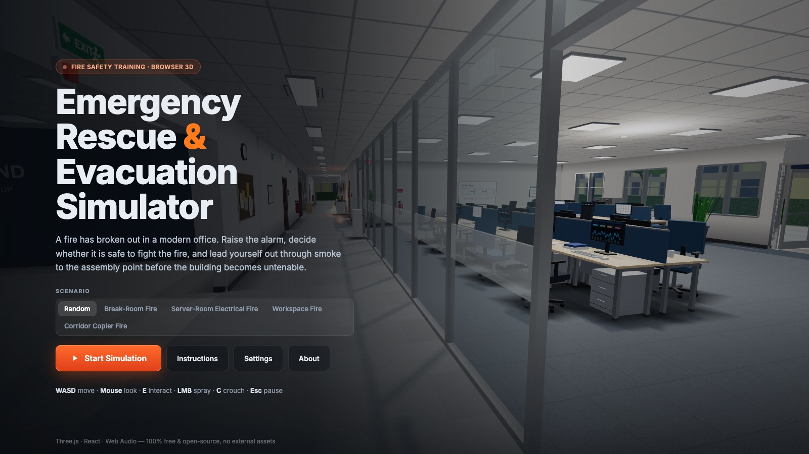

---

## Table of Contents

1. [Overview](#1-overview)
2. [Problem Statement and Motivation](#2-problem-statement-and-motivation)
3. [Objectives](#3-objectives)
4. [Technologies Used](#4-technologies-used)
5. [System Requirements](#5-system-requirements)
6. [Installation and Execution](#6-installation-and-execution)
7. [Gameplay Instructions and Controls](#7-gameplay-instructions-and-controls)
8. [Scenarios](#8-scenarios)
9. [Implemented Features](#9-implemented-features)
10. [Screenshots](#10-screenshots)
11. [Architecture and Folder Structure](#11-architecture-and-folder-structure)
12. [How the Core Systems Work](#12-how-the-core-systems-work)
13. [Testing](#13-testing)
14. [Known Limitations](#14-known-limitations)
15. [Future Enhancements](#15-future-enhancements)
16. [Documentation Index](#16-documentation-index)
17. [Credits, Licences and Author](#17-credits-licences-and-author)

---

## 1. Overview

The **Emergency Rescue & Evacuation Simulator** is an interactive 3D application that runs entirely in
a web browser. You play a person working in a modern corporate office when a fire breaks out. You have
to do what a trained occupant should do in a real emergency:

1. Raise the alarm.
2. Decide whether the fire is small enough to tackle safely.
3. If it is, use a fire extinguisher correctly.
4. Evacuate through spreading fire and smoke to an outdoor assembly point before the building becomes
   untenable.

The whole environment is generated procedurally in code. That includes the office, its furniture,
textures, signage and sound effects. No external 3D models, images or audio files are used. The
application runs locally after `npm install`. It needs no backend, API key or paid service.

## 2. Problem Statement and Motivation

Workplace fire drills are infrequent, scripted and low-stakes. Participants walk calmly to a known
exit, and they rarely experience the decisions that matter in a real fire:

- **When** to raise the alarm.
- **Whether** to fight a fire or leave.
- **How** to use an extinguisher.
- **What** to do when the nearest exit is blocked or the corridor is filling with smoke.

Live-fire training is costly and hazardous. Commercial VR training products are expensive and need
dedicated hardware.

This project explores how computer graphics and real-time simulation can provide a **safe, repeatable,
free and accessible** practice environment. It runs on any desktop browser. It models fire growth,
fire spread, smoke and evacuation routing well enough to reward correct behaviour and to show the
consequences of mistakes.

## 3. Objectives

1. Build a navigable, realistic-looking 3D office environment using procedural geometry, PBR materials,
   lighting and shadows.
2. Implement first-person navigation with mouse look, collision detection, gravity and object
   interaction.
3. Implement a fire simulation: fire growth over time, heat-based propagation between combustible
   zones, smoke generation and particle-based visual effects.
4. Implement a working fire extinguisher with capacity, aiming, range and suppression mechanics.
5. Implement an emergency system with an alarm, a countdown, danger zones and evacuation status.
6. Implement danger-aware evacuation routing with on-screen and in-world guidance.
7. Provide a professional user interface with a HUD, pause menu and debrief/results screen with scoring.
8. Keep the whole project free, open-source, modular and testable.

## 4. Technologies Used

| Technology | Version | Licence | Purpose |
|---|---|---|---|
| [Three.js](https://threejs.org) | 0.169 | MIT | WebGL 3D rendering, scene graph, materials, lights, shadows. Also its `RoomEnvironment` and `BufferGeometryUtils` add-ons |
| [React](https://react.dev) / React DOM | 18.3 | MIT | User interface (menus, HUD, results) |
| [Vite](https://vitejs.dev) + `@vitejs/plugin-react` | 5.4 / 4.3 | MIT | Development server and production bundler |
| Web Audio API | Browser built-in | — | All sound effects, synthesised at runtime |
| Pointer Lock API | Browser built-in | — | First-person mouse look |
| Canvas 2D API | Browser built-in | — | Procedural textures, signage, minimap |
| [puppeteer-core](https://pptr.dev) | 23 (dev only) | Apache-2.0 | Automated end-to-end testing in headless Chrome |
| JavaScript (ES2020+), JSX, CSS | — | — | Implementation languages |

**Why these choices:**

- **Three.js** gives direct control over WebGL rendering without the size or licensing of a game
  engine. The brief explicitly excluded Unity and Unreal.
- The simulation runs as an **imperative engine**. React is used **only for the UI**, which keeps the
  render loop independent of React re-renders.
- **No physics engine** is used. A custom 2D collision solver is sufficient and much lighter, because
  every obstacle in an office is full-height for a walking person.

## 5. System Requirements

| | Minimum | Recommended |
|---|---|---|
| **OS** | Windows 10, macOS 11, or a modern Linux desktop | Same |
| **Browser** | Chrome / Edge 100+, Firefox 100+, Safari 16+ with WebGL 2 | Latest Chrome or Edge |
| **GPU** | Integrated graphics with WebGL 2 support | Discrete or recent integrated GPU |
| **RAM** | 4 GB | 8 GB |
| **Display** | 1280 × 720 | 1920 × 1080 |
| **Input** | Keyboard and mouse | Keyboard and mouse |
| **To build from source** | Node.js 18+ and npm | Node.js 20 LTS |

Touch-only devices are not supported, because the controls depend on Pointer Lock and a keyboard.

## 6. Installation and Execution

```bash
# 1. Clone the repository
git clone https://github.com/aditya-sahay/emergency-rescue-evacuation-simulator.git
cd emergency-rescue-evacuation-simulator

# 2. Install dependencies
npm install

# 3. Run the development server
npm run dev          # open http://localhost:5173
```

**Production build:**

```bash
npm run build        # outputs a static site to dist/
npm run preview      # serves dist/ at http://localhost:4173
```

**Automated tests** (requires Google Chrome installed):

```bash
npm run build
npm run preview &    # keep the preview server running on port 4173
npm run test:e2e
```

**Deployment.** The build output in `dist/` is a static website. It can be hosted on any free static
host, and configuration for Netlify (`netlify.toml`) and Vercel (`vercel.json`) is included.
`vite.config.js` uses `base: './'`, so the build also works from a sub-path such as GitHub Pages.

## 7. Gameplay Instructions and Controls

| Input | Action |
|---|---|
| `W` `A` `S` `D` / arrow keys | Move |
| Mouse | Look around (the cursor is captured while playing) |
| `Shift` | Sprint |
| `C` | Crouch / stand — keeps your head below the smoke layer |
| `Space` | Jump |
| `E` | Interact: open/close doors, pick up extinguishers, press alarm call points |
| Left mouse button (hold) | Spray the extinguisher |
| `G` | Drop the extinguisher |
| `Esc` | Pause menu |

**Recommended response (this is what the scoring rewards):**

1. **Raise the alarm.** Find a red Manual Call Point and press `E`. If nobody does, the smoke detectors
   trigger the alarm 30 s after ignition.
2. **Fight only if safe.** Pick up an extinguisher. Stand 1.5–5 m from the fire, aim at the **base** of
   the flames and hold the left mouse button. The crosshair turns green and the HUD shows
   *"ON TARGET"* when your aim is effective.
3. **Evacuate.** Once the alarm sounds you have **180 seconds**. Follow the green floor arrows and the
   route compass. The route avoids fire and heavy smoke.
4. **Stay low in smoke** (`C`) and **close doors** behind you. Closed doors slow fire and smoke spread.
5. **Reach the assembly point** (the green circle outside an exit). Leaving the building is not enough:
   you must be accounted for at an assembly point.

A full walkthrough is in [docs/USER_GUIDE.md](docs/USER_GUIDE.md).

## 8. Scenarios

| Scenario | Ignition point | Player starts in | Notes |
|---|---|---|---|
| **Break-room fire** | Kitchen counter (`k1`) | Director's office | Fire is near the corridor; the east exit is usually the safest |
| **Server-room electrical fire** | Server rack (`s1`) | Finance office | The route typically leads to the south exit |
| **Workspace fire** | Open-plan workstations (`o2`) | HR office | The fire threatens the south exit route |
| **Corridor copier fire** | Copier in the main corridor (`h2`) | Conference room | The fire is in the evacuation corridor itself |

In every scenario the objective is the same:

- Raise the alarm.
- Act safely.
- Reach an assembly point before the 180-second evacuation clock expires, without losing all your health.

Choose a scenario on the landing page, or select **Random**.

## 9. Implemented Features

### Environment

- A 40 m × 24 m office floor with 9 areas:
  - reception
  - finance office
  - glass-walled conference room
  - director's office
  - open-plan workspace
  - break room / kitchen
  - server & print room
  - HR office
  - main corridor
- Procedurally modelled furniture: desks with monitors, keyboards and drawer pedestals; five-star
  office chairs; a conference table; sofas; bookshelves with individual books; filing cabinets; a
  kitchen with sink and appliances; server racks with status LEDs; copiers; plants; whiteboards;
  wall TVs; clocks.
- Windows with mullions, glass partitions, hinged doors (wooden and glass), glazed exit doors with
  push bars, and exit canopies.
- Safety equipment: 7 fire extinguishers, 5 manual call points, alarm strobes, smoke detectors,
  illuminated EXIT signs, room name plates and 5 "You are here" fire evacuation plans.
- An exterior with paving, parking and cars, trees, lamp posts, boundary hedges, a city skyline and
  3 assembly points.
- Rendering:
  - PBR materials and procedural canvas textures
  - ACES filmic tone mapping and image-based lighting
  - soft directional shadows
  - an approximation of ambient occlusion (contact shadows and corner gradients)

### Simulation

- First-person controller with walking, sprinting, crouching, jumping, gravity, head-bob, footsteps and
  sub-stepped collision detection.
- **Fire model:**
  - 29 combustible zones, logistic fire growth and fuel consumption
  - heat-transfer propagation, attenuated by walls and closed doors
  - smoke rate tied to intensity, danger levels
- **Smoke model:** per-room smoke accumulation and inter-room flow through doors; a descending smoke
  layer; visibility and fog; inhalation damage.
- **Extinguisher:** pickup, a capacity of about 13 s of discharge, range/cone/aim-dependent
  suppression, line-of-sight checks, a discharge particle spray, steam, and on-target coaching
  feedback.
- **Emergency system:** alarm, two-tone sounder, flashing strobes, a 180 s countdown with warnings at
  60, 30 and 10 s, automatic detector activation, and danger zones.
- **Evacuation routing:** Dijkstra's algorithm over a 38-node navigation graph with fire and smoke
  penalties, multi-exit selection with hysteresis, animated floor arrows, a route compass and a live
  minimap.

### User interface

- Landing page with a live 3D cinematic fly-through, scenario selector, instructions, settings and an
  about panel.
- HUD:
  - emergency status, countdown, objective, location and evacuation status
  - minimap, route compass
  - health, visibility, smoke level and posture
  - fire list with danger levels, extinguisher gauge
  - interaction prompts and notifications
  - screen effects for heat, smoke, damage and the alarm strobe
- Pause menu with resume, restart, instructions, settings and main menu.
- Results screen:
  - outcome, evacuation time, fires extinguished, fire exposure, extinguisher use and accuracy
  - score breakdown, S–F rating and best score (saved in `localStorage`)
  - improvement suggestions and an incident timeline
- Settings for quality (Low/Medium/High), mouse sensitivity and volume, saved in `localStorage`.
- All audio is synthesised with the Web Audio API.

## 10. Screenshots

All screenshots were captured from the running application. They were rendered by headless Chrome
with a software WebGL renderer (SwiftShader), so the FPS values shown in the HUD are not
representative of real hardware.

| | |
|---|---|
| 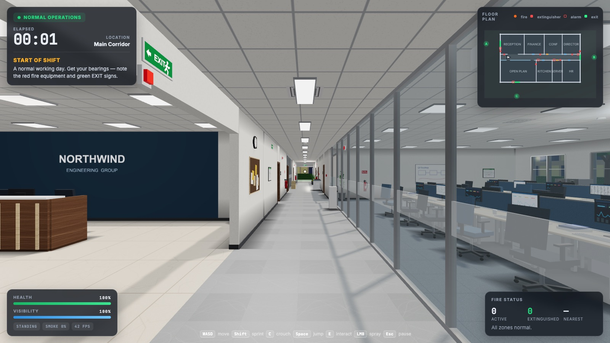 **Main corridor and HUD** | 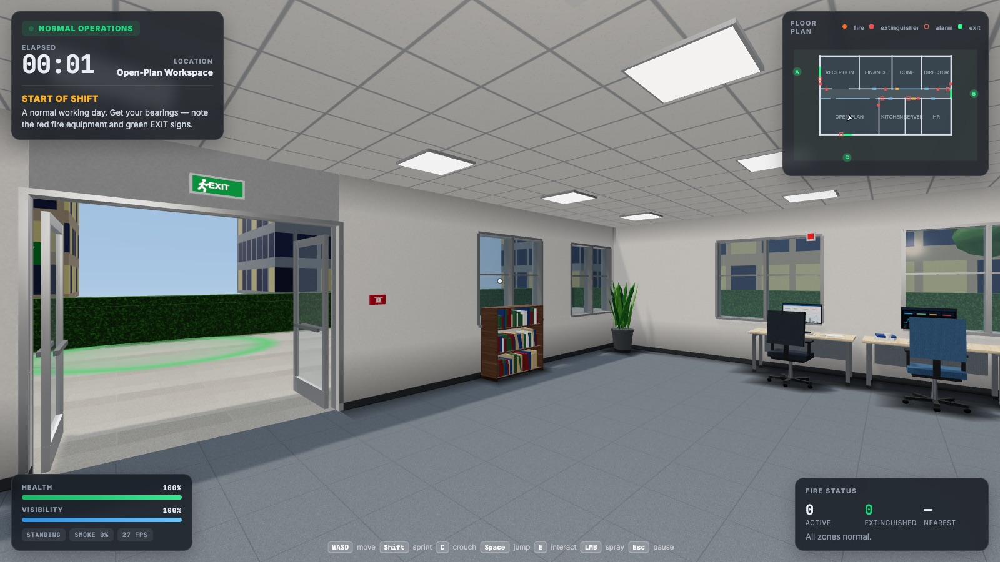 **Open-plan workspace** |
| 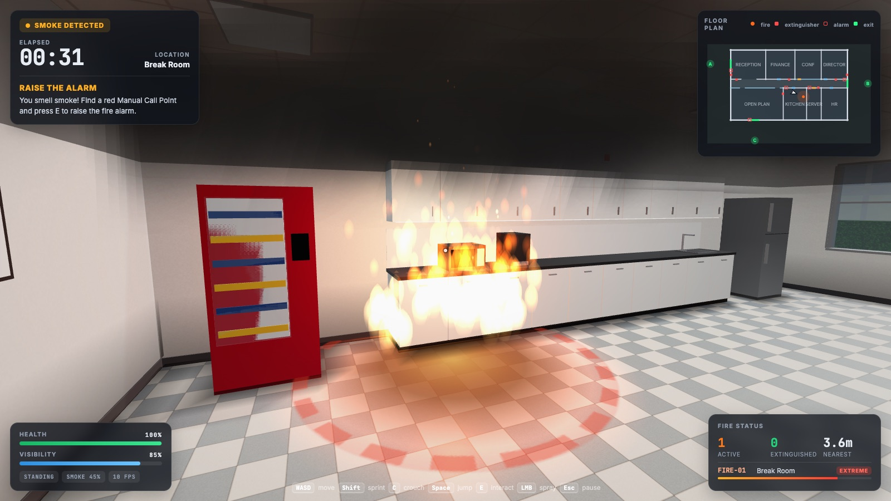 **Break-room fire with danger zone** | 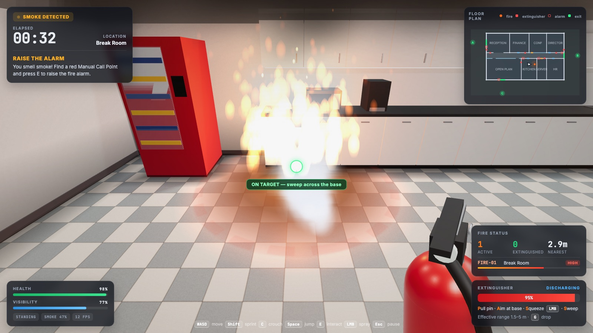 **Using the extinguisher ("ON TARGET")** |
| 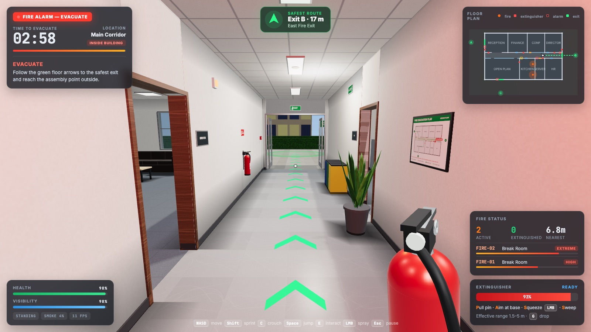 **Alarm raised: floor arrows and route compass** | 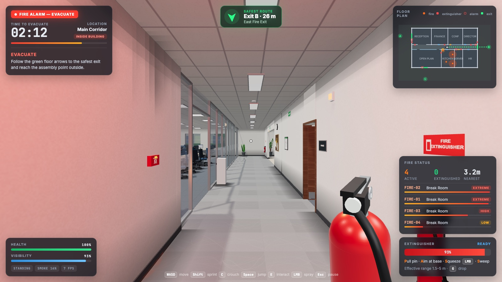 **Fire spread and smoke during evacuation** |
| 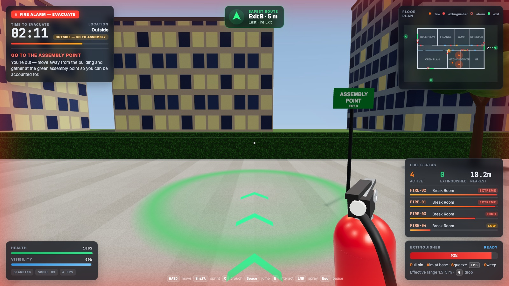 **Outside: heading to the assembly point** | 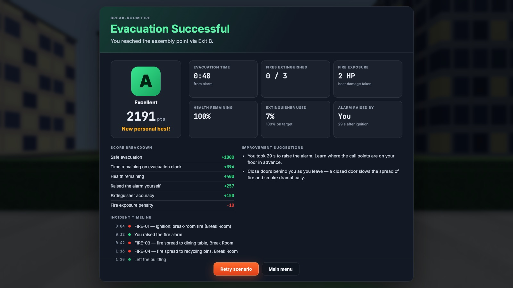 **Results / debrief screen** |
| 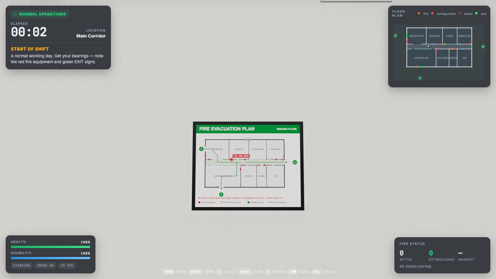 **Generated "You are here" evacuation plan** |  **Landing page** |

## 11. Architecture and Folder Structure

```
emergency-rescue-evacuation-simulator/
├── index.html                    HTML entry point
├── package.json / package-lock.json
├── vite.config.js                Vite build configuration
├── netlify.toml, vercel.json     Optional static-hosting configuration
├── public/favicon.svg
├── src/
│   ├── main.jsx                  React entry
│   ├── App.jsx                   Screen state machine (loading → landing → playing/paused → results)
│   ├── styles.css                UI styling
│   ├── ui/                       Landing, HUD, PauseMenu, Results, Panels (instructions/about/settings)
│   └── engine/
│       ├── Engine.js             Renderer, scene, main loop, sessions, interaction, UI state snapshots
│       ├── Settings.js           Quality presets, localStorage settings and best score
│       ├── environment/
│       │   ├── layout.js         Floor-plan data: rooms, walls, doors, exits, nav graph, combustibles, scenarios
│       │   ├── OfficeBuilder.js  Builds walls, windows, doors, lights, furniture placement, signage, exterior
│       │   ├── furniture.js      Procedural furniture library
│       │   ├── equipment.js      Extinguisher and call-point meshes
│       │   ├── signage.js        Generated "You are here" evacuation plans
│       │   ├── materials.js      PBR material library
│       │   ├── textures.js       Procedural canvas textures and particle sprites
│       │   └── Batcher.js        Geometry merging per material, world-space UVs, Builder API
│       └── systems/
│           ├── CollisionWorld.js   2D AABB collision, spatial grid, segment tests
│           ├── Input.js            Keyboard, mouse, Pointer Lock
│           ├── PlayerController.js First-person movement and physics
│           ├── FireSystem.js       Fire growth, spread, suppression, hazards, fire visuals
│           ├── SmokeSystem.js      Zone smoke model, smoke layer, visibility and fog
│           ├── ParticleSystem.js   Pooled GPU point-sprite particles
│           ├── Extinguisher.js     Extinguisher mechanics and view model
│           ├── EmergencyManager.js Emergency state machine, timers, objectives
│           ├── EvacuationRouter.js Danger-aware routing and floor arrows
│           ├── Minimap.js          Canvas minimap
│           ├── AudioManager.js     Synthesised audio
│           └── ScoreManager.js     Score, rating, suggestions
├── tests/e2e.mjs                 Automated end-to-end test suite (36 checks)
└── docs/                         Report, architecture, user guide, testing, viva, demo guide, screenshots
```

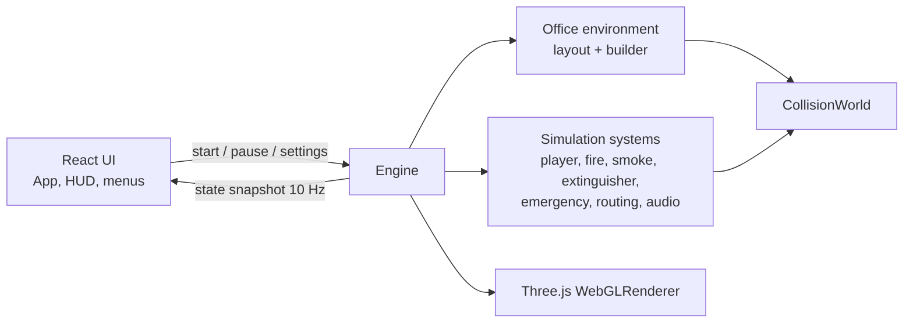

The detailed architecture, data flow and module responsibilities are in
[docs/TECHNICAL_ARCHITECTURE.md](docs/TECHNICAL_ARCHITECTURE.md).

## 12. How the Core Systems Work

### Fire simulation

- Fire can exist only at one of **29 combustible zones**. Each zone has a fuel amount and a
  flammability.
- A fire's intensity *I* (0–1) grows logistically while it has fuel:
  `dI/dt = rate · (0.35 + I) · (1 − I)`. Burning consumes fuel. When the fuel runs out, the fire decays
  and is marked *burned out*.
- Every **0.25 s**, each active fire transfers heat to unburnt zones within 7 m:
  `heat += I · 3.2 · flammability · attenuation / (1 + d²/8)`.
  - The attenuation is 1 with a clear path, 0.12 through one wall or closed door, and 0.03 through two
    or more.
  - Zones also cool slowly.
  - A zone ignites when its accumulated heat reaches **10**.
- Spraying reduces intensity. A fire that reaches zero intensity is marked **extinguished** and cannot
  reignite.

### Smoke

- Each room accumulates smoke in proportion to the smoke rate of its fires.
- Smoke flows between each room and the corridor. The flow is fast through open doorways and very slow
  through closed doors.
- A dark smoke layer descends from the ceiling as the concentration rises.
- Visibility, fog density and inhalation damage depend on whether the player's **eye height** is inside
  that layer. This is why crouching helps.

### Player movement and collision

- The player is a 0.32 m-radius circle in the floor plane. Walls, doors and furniture are axis-aligned
  boxes held in a uniform spatial grid.
- Each frame, the movement is split into sub-steps of at most 0.1 m, which prevents tunnelling. After
  each sub-step the circle is pushed out of any overlapping box, and this is what makes the player
  slide along walls.
- Vertical motion uses gravity of 22 m/s² and a jump velocity of 5.2 m/s.
- The camera is placed at eye height (1.65 m standing, 1.0 m crouching) and rotated by yaw and pitch
  from mouse input.

### Interaction

- A ray is cast from the camera through the screen centre (Three.js `Raycaster`, 2.7 m range) against
  the interactive objects: doors, extinguishers and call points.
- A 2D line-of-sight test then rejects targets that are behind walls or glass.

### Evacuation routing

- **Dijkstra's algorithm** runs over a hand-placed **38-node / 39-edge navigation graph**.
- A virtual start node is connected to every node the player can see. Exits are compared by total cost.
- Edge costs are the length plus penalties for passing near fires (heavy near large flames, so the
  edge is effectively blocked) and for smoke.
- The route is recomputed about 3× per second. It is drawn as animated floor chevrons, a HUD compass
  and a dashed minimap line.

See [docs/PROJECT_REPORT.md](docs/PROJECT_REPORT.md) for the full explanation.

## 13. Testing

- **Automated:** `tests/e2e.mjs` drives the real application in headless Chrome. It runs **36 checks**
  covering:
  - movement, collision, gravity and mouse look
  - doors, alarms and extinguisher mechanics
  - fire spread and smoke-detector activation
  - routing, assembly-point detection, success and failure states
  - the results timeline, restart and main menu
  - absence of console errors

  **Latest run: 36 passed, 0 failed, no console errors.** `npm run build` succeeds.
- **Manual:** the author played through the major gameplay features in a desktop browser.

Details, including what the automated tests cannot cover, are in [docs/TESTING.md](docs/TESTING.md).

## 14. Known Limitations

- The fire and smoke models are **simplified gameplay models**. They are not physically accurate
  combustion or computational fluid dynamics (CFD).
- Ambient occlusion is **approximated** with contact shadows and corner gradients, not computed in
  screen space.
- Point lights from fires do not cast shadows. Instead, a fire's light is dimmed when walls block the
  view of it.
- Routing uses a hand-placed navigation graph, not a navigation mesh.
- There are no other occupants (NPCs). The simulation is single-player and single-floor.
- Desktop only, because it needs Pointer Lock and a keyboard. The UI fonts load from Google Fonts and
  fall back to system fonts offline.
- Frame rate has been verified only on the author's machine and in a software renderer. It has not
  been benchmarked across hardware.

## 15. Future Enhancements

- NPC occupants with crowd evacuation behaviour (for example, a social-force model) and rescue tasks.
- Multi-storey buildings with stairwells and refuge areas.
- WebXR support for head-mounted VR displays and motion controllers.
- Different extinguisher types (water, CO₂, foam, powder) matched to fire classes.
- Instructor mode: custom fire placement, scenario editor, session recording and replay.
- A more physical smoke model, for example a coarse grid-based advection model.
- Multiplayer team drills, and analytics across training sessions.

## 16. Documentation Index

| Document | Contents |
|---|---|
| [docs/PROJECT_REPORT.md](docs/PROJECT_REPORT.md) | Full academic project report, including CGVR concepts |
| [docs/TECHNICAL_ARCHITECTURE.md](docs/TECHNICAL_ARCHITECTURE.md) | Modules, data flow and diagrams |
| [docs/USER_GUIDE.md](docs/USER_GUIDE.md) | Beginner-friendly installation and play guide |
| [docs/TESTING.md](docs/TESTING.md) | Automated and manual testing |
| [docs/VIVA_QUESTIONS.md](docs/VIVA_QUESTIONS.md) | Viva questions and answers |
| [docs/DEMO_GUIDE.md](docs/DEMO_GUIDE.md) | 3–5 minute demonstration script |
| [CHECKLIST.md](CHECKLIST.md) | Development checklist |

## 17. Credits, Licences and Author

**Author:** Aditya Sahay

**Faculty guide:** `[TO BE FILLED]` · **Institution:** `RV College of Engineering`

**Third-party software:**

- Three.js (MIT)
- React and React DOM (MIT)
- Vite and @vitejs/plugin-react (MIT)
- puppeteer-core (Apache-2.0, development only)
- Inter and JetBrains Mono fonts via Google Fonts (SIL Open Font License 1.1)

All transitive npm dependencies use permissive licences (MIT, ISC, BSD, Apache-2.0, 0BSD). The one
exception is `caniuse-lite` (CC-BY-4.0), which is browser-support data used only at build time.

**Assets:** all 3D geometry, textures, signage and sounds were generated procedurally for this
project. No third-party art or audio assets are included. "Northwind Engineering Group" is a fictional
company name.

**Project licence:** MIT, as declared in `package.json`.

> This is an educational simulation. It does not replace certified fire-safety training. Always follow
> your organisation's fire procedures.
