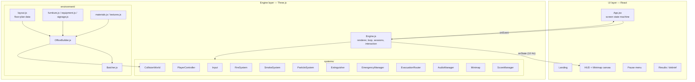

# Project Report

# Emergency Rescue & Evacuation Simulator

### A Browser-Based First-Person 3D Fire Emergency Training Simulator

*Computer Graphics & Virtual Reality (CGVR) Laboratory Project*

| | |
|---|---|
| **Submitted by** | Aditya Sahay |
| **USN / Registration No.** | `[TO BE FILLED]` |
| **Semester / Section** | `[TO BE FILLED]` |
| **Department** | `[TO BE FILLED]` |
| **Institution** | `[TO BE FILLED]` |
| **Under the guidance of** | `[TO BE FILLED: faculty guide name and designation]` |
| **Academic Year** | `[TO BE FILLED]` |
| **Date of Submission** | `[TO BE FILLED]` |

> Certificate, declaration and acknowledgement pages are institution-specific. Add them in the format
> your department prescribes.

---

## Table of Contents

1. [Abstract](#1-abstract)
2. [Introduction](#2-introduction)
3. [Problem Statement](#3-problem-statement)
4. [Objectives](#4-objectives)
5. [Scope of the Project](#5-scope-of-the-project)
6. [Hardware and Software Requirements](#6-hardware-and-software-requirements)
7. [Technologies Used](#7-technologies-used)
8. [System Architecture](#8-system-architecture)
9. [Implementation Details](#9-implementation-details)
10. [Computer Graphics Concepts Used](#10-computer-graphics-concepts-used)
11. [Virtual Reality and Interaction Concepts](#11-virtual-reality-and-interaction-concepts)
12. [Fire and Smoke Simulation](#12-fire-and-smoke-simulation)
13. [Collision Detection and Player Physics](#13-collision-detection-and-player-physics)
14. [Lighting, Materials, Shadows and Environment Design](#14-lighting-materials-shadows-and-environment-design)
15. [Evacuation Pathfinding and Navigation](#15-evacuation-pathfinding-and-navigation)
16. [User Interface and Interaction](#16-user-interface-and-interaction)
17. [Testing and Results](#17-testing-and-results)
18. [Limitations](#18-limitations)
19. [Future Scope](#19-future-scope)
20. [Conclusion](#20-conclusion)
21. [References](#21-references)

---

## 1. Abstract

This project presents the **Emergency Rescue & Evacuation Simulator**, an interactive first-person 3D
training application for office fire emergencies. It is implemented in JavaScript using **Three.js**
(a WebGL rendering library) and **React**, and it runs entirely in a web browser.

The simulator renders a procedurally constructed corporate office of about 40 m × 24 m with nine
connected areas. It uses physically based materials, image-based lighting, shadow mapping and an
approximation of ambient occlusion. All furniture, textures, signage and sounds are generated by code,
and no external asset files are used.

At run time, the simulator:

- models fire growth and propagation between 29 combustible zones using a heat-transfer approximation;
- simulates room-level smoke accumulation and flow with a descending smoke layer;
- renders flames, embers, smoke, steam and extinguisher discharge with GPU point-sprite particle
  systems.

The player moves with mouse-look first-person controls, gravity and collision detection. They interact
with doors, alarm call points and fire extinguishers through raycasting. They are guided by
danger-aware evacuation routing based on Dijkstra's shortest-path algorithm.

Performance is scored and summarised in a debrief that includes improvement suggestions and an
incident timeline. An automated end-to-end test suite of 36 checks verifies the core behaviour.

The project demonstrates how core computer graphics and interactive simulation techniques combine to
produce a free, accessible and repeatable safety-training tool.

## 2. Introduction

Fire is one of the most common and dangerous workplace emergencies. Survival depends heavily on
occupant behaviour in the first minutes, for example:

- raising the alarm early;
- choosing correctly between fighting a small fire and evacuating;
- using an extinguisher properly;
- avoiding smoke;
- following a safe route to an assembly point.

Conventional fire drills rehearse only the walk to a known exit, under calm and predictable
conditions.

Interactive 3D simulation offers an alternative. A virtual environment can reproduce dynamic hazards
(a spreading fire, a corridor filling with smoke, a blocked exit) with no physical risk. It can be
repeated as often as needed, and it can measure the trainee's decisions objectively.

Recent advances in browser graphics (WebGL 2) mean such a simulator no longer needs a game engine or
specialised hardware. It can run on an ordinary laptop from a web link.

This report describes the design and implementation of such a simulator. It places particular
emphasis on the computer graphics and virtual reality concepts it puts into practice: scene
construction, transformations, projection, lighting and shading, particle systems, collision
detection, raycasting and real-time interactive rendering.

## 3. Problem Statement

> To design and implement a realistic, interactive, first-person 3D simulation of an office fire
> emergency that runs in a standard web browser using only free and open-source technology. In the
> simulation, a user must raise the alarm, optionally suppress a fire with a correctly used extinguisher,
> and evacuate safely through dynamically spreading fire and smoke, guided by danger-aware route
> guidance. Their performance is assessed and explained afterwards.

The constraints given for the project were:

- no paid software, assets or services;
- no proprietary game engines (Unity and Unreal were excluded);
- the application must run locally without any backend or API keys;
- it must be demonstrable on a normal desktop computer.

## 4. Objectives

1. Construct a recognisable and visually convincing 3D office environment using **procedural
   geometry**, **PBR materials**, **lighting** and **shadows**.
2. Implement **first-person navigation**: perspective camera, mouse look via the Pointer Lock API,
   keyboard movement, sprinting, crouching, **gravity** and **jumping**.
3. Implement **collision detection** so the player cannot pass through walls, doors or furniture.
4. Implement **object interaction** (doors, alarms, extinguishers) using **raycasting**.
5. Implement a **fire simulation** with per-fire state, growth over time, heat-based propagation,
   smoke generation and **particle-based** visual effects.
6. Implement **fire extinguisher** mechanics with capacity, aiming, range and visible suppression.
7. Implement an **emergency system** (alarm, strobes, countdown, danger zones) and **evacuation
   routing** that avoids fire and smoke.
8. Provide a **professional UI**: landing page, HUD, minimap, pause menu and results screen with scoring.
9. Keep the system **modular**, **performant** and **verifiable by automated tests**.

## 5. Scope of the Project

**In scope:**

- A single-storey office floor with interior rooms, a corridor, three exits and an exterior site.
- One player in first-person view, with keyboard and mouse.
- Four predefined fire scenarios (or a random choice among them).
- Gameplay-level fire, smoke, extinguisher, alarm and evacuation mechanics.
- Scoring, debrief and locally stored settings and best score.
- Desktop web browsers with WebGL 2.

**Out of scope:**

- Physically accurate combustion chemistry or computational fluid dynamics.
- NPC occupants, crowd simulation and multi-storey buildings.
- Head-mounted VR display support (WebXR), mobile/touch input and multiplayer.
- Any server-side component.

## 6. Hardware and Software Requirements

### Hardware

| Component | Minimum | Recommended |
|---|---|---|
| Processor | Dual-core 64-bit CPU | Quad-core CPU |
| Memory | 4 GB RAM | 8 GB RAM |
| Graphics | Integrated GPU with WebGL 2 | Discrete or recent integrated GPU |
| Display | 1280 × 720 | 1920 × 1080 |
| Input | Keyboard and mouse | Keyboard and mouse |

### Software

| Component | Requirement |
|---|---|
| Operating system | Windows 10+, macOS 11+, or a modern Linux desktop |
| Browser | Chrome/Edge 100+, Firefox 100+, Safari 16+ (WebGL 2, Pointer Lock, Web Audio) |
| Development | Node.js 18+ (20 LTS recommended), npm |
| Testing (optional) | Google Chrome (used by the automated test suite) |

## 7. Technologies Used

| Technology | Role in the project |
|---|---|
| **Three.js 0.169** (MIT) | Scene graph, cameras, `BufferGeometry`, PBR materials, lights, shadow mapping, `Raycaster`, `InstancedMesh`, custom `ShaderMaterial`, `RoomEnvironment` (image-based lighting) and `BufferGeometryUtils.mergeGeometries` (batching) |
| **WebGL 2** (via Three.js) | GPU rasterisation and programmable shaders (GLSL) |
| **React 18** (MIT) | Declarative user interface: landing page, HUD, menus and results |
| **Vite 5** (MIT) | Development server with hot module replacement; optimised production bundling |
| **Canvas 2D API** | Procedural textures (carpet, wood, tiles, marble, signage, screens), particle sprites, evacuation plans, minimap |
| **Web Audio API** | Synthesised alarm sounder, fire crackle and rumble, extinguisher hiss, footsteps and UI sounds |
| **Pointer Lock API** | Unbounded relative mouse movement for first-person look |
| **localStorage** | Persisting settings and the best score |
| **puppeteer-core** (Apache-2.0, development only) | Driving headless Chrome for end-to-end tests |

**Selection rationale:**

- **Three.js** offers low-level control of WebGL with a mature, well-documented API. It has no
  licensing cost and ships no editor runtime. This fits a project where most content is generated in
  code.
- **React** is used **only** for the 2D interface. The 3D simulation runs in an imperative engine
  with its own render loop, so React re-renders never affect frame timing.
- **No physics engine** is used: see [Section 13](#13-collision-detection-and-player-physics).

## 8. System Architecture

The application is split into a **UI layer** (React) and an **engine layer** (plain JavaScript and
Three.js).



The key architectural decisions are:

- **Data-driven level.** `layout.js` defines every room, wall run and gap (door, opening or exit),
  door behaviour, exit, navigation node and edge, combustible zone, equipment position and scenario.
  The geometry, collision, minimap, evacuation plans, routing and fire zones are all generated from
  this single source of truth.
- **Engine-to-UI communication.** The engine publishes a compact state snapshot about 10 times per
  second through a callback, plus discrete events (notifications, pause, end of session). The UI calls
  a small engine API: `startSession`, `pause`, `resume`, `restart`, `toMenu` and `applySettings`.
- **Batching.** Static geometry is merged by material, so the whole office renders in roughly 80 draw
  calls.

[TECHNICAL_ARCHITECTURE.md](TECHNICAL_ARCHITECTURE.md) documents each module in detail.

## 9. Implementation Details

### 9.1 Main loop

`Engine._loop()` is driven by `requestAnimationFrame`. Each frame it does the following:

1. Measure the elapsed time `dt`, clamped to 50 ms so that a stalled tab cannot cause huge simulation
   steps.
2. Depending on the mode:
   - **attract mode** (landing page): move the camera along a closed Catmull–Rom spline through the
     office and animate decorative fires;
   - **play mode**: update the systems in dependency order (see below);
   - **ended mode**: keep particles drifting.
3. Render the 3D scene. If an extinguisher is held, clear the depth buffer and render the first-person
   view model in a second pass.
4. Clear edge-triggered input.

In play mode the systems update in this order:

```
player → interaction raycast → extinguisher → fire → smoke → hazards/health
       → emergency state machine → routing (≈3 Hz) → floor arrows → alarm effects → audio → UI snapshot
```

### 9.2 Session lifecycle

`startSession(scenarioId)` resets every system to its initial state. That covers fires, smoke,
extinguishers, doors, call points, the router and the timeline. It then places the player at the
scenario's start position. Because the static geometry is built only once, restarting is instant.

### 9.3 Emergency state machine

`EmergencyManager` moves through the states **normal → fire → alarm → ended**:

- Ignition happens 4 s after the start.
- If no call point has been pressed, the alarm is raised automatically 30 s after ignition ("smoke
  detectors").
- The alarm starts a 180 s evacuation clock.
- The session ends with **evacuated** when the player reaches an assembly point. It ends with
  **failed** when health reaches zero or the clock expires.
- The manager also produces the current objective text.

### 9.4 Scoring

`ScoreManager.computeResults` builds an itemised score from the session statistics.

| Item | Points |
|---|---|
| Safe evacuation | +1000 |
| Time remaining on the evacuation clock | +3 per second |
| Health remaining | +4 per percent |
| Raising the alarm yourself | +250, plus a speed bonus |
| Each fire extinguished | +175 |
| Extinguisher accuracy | up to +150 |
| Closing doors behind you | +40 each, up to 3 doors |
| Heat exposure | −6 per HP of fire damage |
| Failure to reach safety | −200 |

The total is mapped to a rating from S to F. The function also generates targeted suggestions, for
example about P.A.S.S. technique, crouching in smoke or raising the alarm sooner. The engine records an
incident timeline (ignition, alarm, spread, extinguishment, exit, outcome) for the debrief.

## 10. Computer Graphics Concepts Used

This section explains how the project **implements** each concept, with references to the code.

### 10.1 3D scene construction and procedural geometry

The scene is a Three.js **scene graph**: a tree of `Object3D` nodes, each with a local transform.
Almost everything in it is generated procedurally from primitives:

- **Walls** (`OfficeBuilder.js`). Each wall run is split at its gaps into solid segments. Each segment
  becomes a box `[length × height × 0.2 m]`. Doors and openings get a header above the gap. Exterior
  walls are assembled from continuous bands below the sills and above the window heads, with piers
  between windows, so that every joint is hidden behind a window frame.
- **Furniture** (`furniture.js`). Each item is a composition of boxes, cylinders, spheres, cones and
  ellipsoids. For example, an office chair is built from five rotated spokes with caster spheres, a gas
  lift cylinder, a seat, a tilted backrest and armrests.
- **The Builder API** (`Batcher.js`). A `Builder` holds a **local coordinate frame** (a 4×4 matrix).
  `b.at(x, y, z, ry)` returns a child builder whose matrix is `parent × T(x,y,z) × Ry(ry)`. This is
  hierarchical modelling: the furniture functions place parts in local coordinates, and the
  composed matrix places them in the world.

### 10.2 Transformations and coordinate systems

The world uses metres, with a right-handed system: X runs east, Y up and Z south.

Every primitive is placed using a **model matrix** composed from translation, rotation (Euler angles
converted to a quaternion) and scale:

```
M = T · R · S
```

This is done by `Matrix4.compose(position, quaternion, scale)`.

Leaf blades use the Euler order **YXZ**: the blade is first tilted outward (rotation about X) and
then turned around the stem (rotation about Y), giving a natural radial arrangement.

The camera itself uses Euler order **YXZ** (yaw, then pitch). This is the standard first-person
convention, and it prevents roll from creeping in.

### 10.3 Meshes, materials and textures

- **Meshes.** Geometry is stored as `BufferGeometry`: typed arrays of positions, normals, UVs and
  indices. To reduce **draw calls**, `Batcher.build()` transforms every part into world space and
  merges all parts sharing a material into a single mesh (`mergeGeometries`). The whole office
  (thousands of parts) is drawn in about 80 calls, around 117k triangles.
- **Materials.** `MeshStandardMaterial` is used throughout. It is a **physically based** model
  (metalness/roughness, GGX microfacet specular). Values were chosen per surface: brushed aluminium
  has metalness 0.75 and roughness 0.35; carpet has roughness 1; polished tile has roughness 0.32.
  Glass uses transparency with `depthWrite` disabled.
- **Procedural textures** (`textures.js`). These are drawn at run time on HTML canvases and uploaded
  as `CanvasTexture`s:
  - carpet fibres, wood grain (sinusoidal stripes plus noise), marble veining (Bézier curves), tiles
    with grout, fabric weave, ceiling tiles, grass, paving, building facades;
  - signage (EXIT signs, extinguisher and call-point labels, room plates), monitor screens, a clock
    face and a whiteboard drawing;
  - deterministic noise from a seeded PRNG, so textures are identical on every run.
- **World-space UV mapping.** Merged boxes of arbitrary size would stretch their textures. To avoid
  this, the batcher recomputes UVs by **box projection**. For each vertex it picks the dominant axis
  of the normal and uses the other two world coordinates, divided by a per-material scale, as `(u, v)`.
  As a result, a 0.6 m carpet tile is always 0.6 m wide.

### 10.4 Perspective projection and camera control

The main camera is a `PerspectiveCamera` with a 72° vertical field of view, a near plane of 0.1 m and
a far plane of 250 m. Its projection matrix maps the view frustum to clip space, so that apparent size
falls off as 1/z.

The near plane was deliberately raised from 0.05 m to 0.1 m during development. Depth-buffer precision
is roughly proportional to `z²/near`, and with the smaller value, floor decals 1 cm above the floor
were lost to z-fighting.

The aspect ratio and projection matrix are updated on window resize.

The extinguisher **view model** uses a second camera (60° FOV, near plane 0.01 m) in a separate scene.
The engine renders the world, clears **only the depth buffer**, then renders the view model. The held
object therefore always draws on top and never clips into walls.

### 10.5 First-person navigation and mouse look

`PlayerController` keeps a **yaw** angle (about Y) and a **pitch** angle (about X):

- Mouse deltas from the Pointer Lock API are scaled by the sensitivity and added to these angles.
- Pitch is clamped to ±1.45 rad (about ±83°) to prevent the view from flipping over.

Movement intent from WASD is rotated into world space using the yaw:

```
forward = (−sin yaw, 0, −cos yaw)
right   = ( cos yaw, 0, −sin yaw)
```

The result is normalised, so moving diagonally is not faster than moving straight.

Velocity approaches the target speed exponentially (`v += (target − v)·(1 − e^(−k·dt))`), which gives
smooth acceleration that is independent of frame rate. The speeds are:

| Mode | Speed |
|---|---|
| Walk | 3.0 m/s |
| Sprint | 5.4 m/s |
| Crouch | 1.6 m/s |

Eye height is 1.65 m standing and 1.0 m crouching, interpolated smoothly between the two.

A sinusoidal **head-bob** is applied while moving. Footstep sounds fire each half-period of that bob.

### 10.6 Lighting, shadows and visual effects

See [Section 14](#14-lighting-materials-shadows-and-environment-design) for the full description. In
summary, the scene combines:

- a shadow-casting directional "sun" light (shadow map up to 4096²);
- a hemisphere light;
- **image-based lighting** from a pre-filtered (PMREM) room environment map;
- five interior fill point lights;
- emissive ceiling panels;
- pooled flickering fire lights and a flashing red alarm light;
- ACES filmic tone mapping into the sRGB colour space.

### 10.7 Particle systems and animated fire/embers

`ParticleSystem.js` implements a **pooled point-sprite particle system**:

- **Storage.** Each pool keeps typed arrays for position, velocity, life, size and RGBA colour. A ring
  buffer reuses the oldest particle when the pool is full, so nothing is allocated at run time.
- **Simulation (CPU).** Each frame applies, per particle:
  - buoyancy (upward acceleration) or gravity;
  - exponential **drag** (`v *= e^(−drag·dt)`);
  - sinusoidal **turbulence** that depends on position and time;
  - an optional **ceiling clamp**: rising smoke hits the ceiling and is deflected sideways;
  - clamping to the fire's **room bounds**.
- **Appearance over life.** Colour and alpha are interpolated through a gradient over normalised age
  `t ∈ [0, 1]`. Flames go white-yellow → orange → red → transparent. Size is interpolated from a start
  value to an end value.
- **Rendering (GPU).** Each pool is a single `THREE.Points` draw call with a custom `ShaderMaterial`.
  The vertex shader computes a **perspective-correct point size**:

  ```
  gl_PointSize = size × scale / −z_view,   where scale = viewportHeight / (2·tan(fov/2))
  ```

  This makes particle size behave like a world-space size. The fragment shader multiplies the vertex
  colour by a sprite texture sampled at `gl_PointCoord`, and integrates Three.js fog.
- **Blending.**
  - **Flames and embers** use **additive blending**: overlapping particles brighten toward white like
    real flame.
  - **Smoke, steam and extinguisher spray** use normal alpha blending.
  - All particles disable depth writes, so they do not occlude one another incorrectly.

| Pool | Capacity |
|---|---|
| Flames and embers | 3200 |
| Smoke | 1600 |
| Steam | 500 |
| Extinguisher spray | 900 |

The **flame sprite** is a procedurally drawn teardrop with a bright core.

**Embers** are small, long-lived and fast-rising particles emitted from the same additive pool.

The emission rate, emission radius, initial velocity and particle size all scale with fire intensity,
so a growing fire visibly becomes larger, taller and denser.

### 10.8 Smoke rendering and visual representation

Smoke is shown at three scales:

1. **Near the fire:** smoke particles with a noisy puff sprite rise, hit the ceiling and spread out.
   They stay inside the room where they were emitted.
2. **Room scale:** for each room there is a **smoke layer**, a pair of large horizontal transparent
   planes. Their height falls from the ceiling toward 0.7 m and their opacity increases as the room's
   smoke concentration grows. The texture offset is animated so the layer drifts.
3. **Visibility:** exponential-squared fog (`FogExp2`) whose density and colour depend on the local
   smoke concentration at the player's head, plus a screen-space smoke vignette in the HUD.

### 10.9 Collision detection

`CollisionWorld.js` is a 2D **broad-phase / narrow-phase** system:

- **Broad phase:** axis-aligned bounding boxes (AABBs) are stored in a **uniform spatial hash grid**
  with 2 m cells. A query only tests boxes in the overlapped cells, and a per-query stamp prevents
  testing the same box twice.
- **Narrow phase:** circle-versus-AABB tests (clamping the circle centre to the box gives the closest
  point) with positional correction along the penetration normal.
- **Segment tests:** a slab-method ray/segment-versus-AABB test is used for line of sight (interaction,
  spray, routing) and for counting walls between fires (heat attenuation).

[Section 13](#13-collision-detection-and-player-physics) explains this fully.

### 10.10 Gravity, jumping and movement physics

Vertical motion is integrated explicitly each frame:

- `vy −= g·dt` with g = 22 m/s² (slightly stronger than real gravity, for responsive game feel);
- `y += vy·dt`;
- landing on the floor plane (y = 0) clears vertical velocity and sets `onGround`;
- a jump sets `vy = 5.2 m/s`, which gives about 0.6 m of jump height;
- horizontal control is reduced in the air (acceleration 3 instead of 14).

### 10.11 Raycasting and interaction detection

Every frame the engine casts a **ray from the camera through the centre of the screen**
(`Raycaster.setFromCamera` with NDC (0, 0)) with a maximum distance of 2.7 m, against the list of
interactive meshes: door leaves, extinguisher models and call points. Each mesh carries
`userData.interact`, which describes its type and target.

The nearest hit is then validated with a **2D line-of-sight test** from the camera to a point 0.25 m
in front of the hit point. This prevents interacting through walls or glass.

The result drives the on-screen prompt (for example `[E] Open door`) and the action when `E` is
pressed.

The extinguisher uses a related **analytic cone test** rather than a mesh raycast; see
[Section 12.4](#124-extinguisher-suppression-model).

### 10.12 Real-time rendering and interactive simulation

The project meets real-time constraints through several measures:

- geometry batching (≈80 draw calls);
- one draw call per particle pool;
- `InstancedMesh` for the up to 70 animated route chevrons;
- a **fixed light count**: fire lights are pooled and their intensity changed, never added or
  removed, so shader programs are never recompiled during play;
- throttled routing (≈3 Hz) and UI updates (10 Hz);
- a minimap whose static floor plan is pre-rendered once to an off-screen canvas;
- clamped time steps;
- quality presets that trade shadow-map size, pixel ratio and particle counts for speed.

Simulation and rendering share a single loop, so every user action (opening a door, spraying, closing
a door to block heat) is reflected in the next frame.

## 11. Virtual Reality and Interaction Concepts

The project is a **desktop (non-immersive) virtual reality** application. It builds the sense of
presence through first-person perspective, spatial audio cues and responsive interaction rather than
through a head-mounted display.

| VR concept | How it is realised |
|---|---|
| **Immersion and presence** | First-person viewpoint at human eye height; head-bob and footsteps; an enveloping alarm sound; screen-space heat, smoke and damage effects; consistent real-world scale (desks 0.74 m high, doors 2.1 m) |
| **Navigation** | Continuous steering locomotion (WASD with mouse look), sprint and crouch; collision with the environment; wall sliding |
| **Selection and manipulation** | Ray-cast gaze selection at the screen centre, with contextual prompts; direct manipulation (opening a door swings it on its hinge; pressing a call point raises a flag) |
| **Tool use** | A held extinguisher rendered as a body-locked view model that animates (raise on pickup, recoil and lever press while spraying, bob while walking) |
| **Wayfinding aids** | World-space cues (floor chevrons, EXIT signs, evacuation plans) and screen-space cues (route compass, minimap, objective text) |
| **Feedback** | Visual (green crosshair when on target, danger rings, alarm strobes), auditory (crackle volume tied to fire proximity, spray hiss, warning tones) and textual (coaching hints, notifications) |
| **Simulation fidelity** | Hazards respond to the user's actions: closing doors reduces heat transfer and smoke flow, crouching lowers smoke exposure, spraying reduces fire intensity |
| **Safety training value** | A safe environment that can be repeated as often as needed, with objective measurement and a debrief, which are the main benefits of VR training |

The architecture separates input, camera and interaction, so it could be extended to **WebXR**
(head-mounted displays and tracked controllers) without changing the simulation systems. See
[Section 19](#19-future-scope).

## 12. Fire and Smoke Simulation

### 12.1 Fire state

Each fire object stores the following.

| Field | Meaning |
|---|---|
| `id` | Unique identifier, e.g. `FIRE-03` |
| `position` | World position of its combustible zone |
| `intensity` | Value from 0 to 1 |
| `spreadRate` | `0.032 × (0.5 + flammability)` |
| `fuel` | Remaining seconds of burning at full intensity |
| `active`, `extinguished`, `burnedOut` | Status flags |
| `smokeRate` | `0.3 + 1.4 × intensity` |
| `danger` | `low` / `moderate` / `high` / `extreme`, by intensity band |
| room, burn time, timestamps | Bookkeeping |

### 12.2 Growth and fuel

While fuel remains and the fire is not being sprayed, intensity grows **logistically**:

```
dI/dt = spreadRate · (0.35 + I) · (1 − I)
```

Growth is slow when the fire is small, fastest at medium intensity, and levels off as it approaches
full intensity. Fuel decreases by `I·dt`. When the fuel is exhausted, intensity decays at 0.04/s and the
fire is marked *burned out*.

### 12.3 Propagation (heat transfer)

Fire spread is computed from simulation logic, not randomness. Every 0.25 s, each intact zone gains
heat from every active fire within 7 m:

```
gain = Σ  I_f · 3.2 · flammability_z · A(f, z) / (1 + d²/8)
heat_z = max(0, heat_z + (gain − 0.15) · Δt)
```

- `d` is the distance between the fire and the zone.
- `A(f, z)` is the **attenuation**, found by counting walls and closed doors crossed by the segment
  from the fire to the zone (using `CollisionWorld.segmentHits`): 1 for none, 0.12 for one, 0.03 for
  two or more.
- The `−0.15` term is cooling.

When `heat_z ≥ 10`, the zone ignites as a new fire at intensity 0.15. Because doors are dynamic
colliders, **closing a door measurably slows spread**.

### 12.4 Extinguisher suppression model

While the left mouse button is held:

- capacity drains at 7.5 % per second (about 13 s in total);
- for each active fire, an analytic **cone test** is evaluated against two target points: the base of
  the flames (weight 1.0) and the upper flames (weight 0.45).

For each target point the cone test computes:

- the distance **along** the camera's forward vector (it must be between 0.2 and 7.5 m);
- the **perpendicular distance** from that axis.

A target counts as hit if the perpendicular distance is within the tolerance
`0.35 + 0.65·I + 0.1·along`.

The resulting effectiveness is then adjusted:

- It falls off linearly beyond 5 m.
- It is scaled by how centred the hit is.
- It is zeroed if a wall or glass lies between the player and the fire.

Intensity is then reduced by `0.2 · effectiveness · dt`, and fire growth pauses while the fire is being
sprayed. A fire whose intensity falls to 0.02 or below is **extinguished**. The engine reports
on-target status and coaching hints ("too far", "obstructed", "aim at the base") to the HUD.

### 12.5 Smoke model

Smoke is modelled per room, as a concentration between 0 and 1.

1. **Source:** each fire adds `smokeRate · 2.2 · dt / roomArea`.
2. **Exchange:** each room exchanges smoke with the corridor in proportion to the concentration
   difference. The rate is 0.12 for an open doorway, 0.07 for an open door and 0.004 for a closed door.
   The transfer is weighted by room areas, so the total amount of smoke is conserved.
3. **Ventilation:** a small constant leakage.
4. **Smoke layer height:** `y = 3.0 − 2.3 · smoke`.
5. **Local visibility loss:**

   ```
   loss = smoke · (0.25 + 0.85 · head) + near-fire term
   ```

   `head` measures how far the eye is above the layer. Visibility loss sets the fog density
   `0.004 + loss^1.4 · 0.32` and blends the fog colour toward dark grey.
6. **Inhalation damage:** `(loss − 0.15) · 5.5` HP/s when the loss is above 0.2.

**Thermal hazard:**

- Inside a fire's danger radius (`0.5 + 1.5·I`) the player takes `22·I + 6` HP/s.
- Within a wider radiant-heat zone the damage tapers with distance.
- Walls block radiant heat (line-of-sight test).

## 13. Collision Detection and Player Physics

**Why not a physics engine?** In an office, every obstacle a walking person can collide with (walls,
doors, desks, cabinets, chairs) is effectively full-height. Collision can therefore be solved exactly
in the 2D floor plane, while the vertical axis is handled separately by gravity and the flat floor.
This is far cheaper and simpler than a general rigid-body engine, and it adds no dependency.

**Representation.**

- The player is a circle of radius 0.32 m.
- Obstacles are AABBs, generated from wall segments, closed doors, open door leaves, exit door leaves,
  furniture footprints and the boundary hedges.
- Footprints of rotated furniture are converted to the enclosing AABB of the four transformed corners
  (`Builder.collider`).
- Each box has a **tag** (`wall`, `door`, `furniture`) so that queries can filter it. For example, heat
  and line of sight are blocked only by walls and doors.
- Each box has an `enabled` flag. Doors toggle between a "closed" box across the doorway and an "open"
  box along the swung leaf as they animate.

**Algorithm, per frame:**

1. Compute the desired displacement `v·dt`.
2. Split it into `n = ceil(|v·dt| / 0.1 m)` sub-steps, so a fast player cannot **tunnel** through a
   0.2 m wall.
3. For each sub-step, move, then call `resolveCircle`, which runs up to three relaxation iterations:
   - For each nearby box, find the closest point on the box to the circle centre.
   - If its distance `d < r`, push the centre out along the normal by `r − d`.
   - If the centre is inside the box, push it out along the axis of least penetration.
4. Because only the penetrating component is removed, the remaining motion slides along the surface.
   This is **wall sliding**, and it is verified by an automated test.
5. If the actual speed is far below the intended speed (the player is blocked), the velocity is
   damped.

**Vertical physics** is covered in [Section 10.10](#1010-gravity-jumping-and-movement-physics).

## 14. Lighting, Materials, Shadows and Environment Design

**Lighting rig:**

| Light | Purpose |
|---|---|
| `DirectionalLight` (2.2), position (32, 45, 26) | Key "sun" light; casts **PCF soft shadows** with an orthographic shadow camera covering the site. Shadow map 2048² (Medium) or 4096² (High); bias and normal bias tuned against acne |
| `HemisphereLight` (sky blue / ground brown, 0.7) | Ambient fill with a vertical gradient |
| **Image-based lighting** | `RoomEnvironment` pre-filtered with `PMREMGenerator` into a mip-mapped environment map. Provides realistic diffuse and specular reflections for PBR materials (`environmentIntensity` 0.42) |
| 5 interior `PointLight`s | Local fill in large rooms |
| Emissive ceiling panels | Visible light sources (`emissiveIntensity` 2.2) |
| 4 pooled fire `PointLight`s | Assigned each frame to the most significant fires; intensity flickers using products of sines; range and intensity scale with fire intensity |
| Red alarm `PointLight` | Follows the player's room and strobes with the alarm pattern |

**Handling unshadowed fire lights.** Point lights that do not cast shadows would light walls in
adjacent rooms. To avoid this:

- A fire's light is dimmed to 22% when the camera has no line of sight to it. The change is smoothed
  over time to avoid popping.
- The light's range is kept short (3.5–8 m).

**Tone mapping and colour.** The renderer uses ACES filmic tone mapping (exposure 0.82) and outputs
sRGB. Colour textures are tagged as sRGB, and data textures (sprites, masks) as linear.

**Shadow-casting policy:**

- Walls, furniture and equipment cast and receive shadows.
- Ceilings, the roof, light fixtures, glass and decals do not cast. Otherwise the overhead light
  would be blocked entirely, and ceiling fixtures would project floating squares onto the floor.

**Approximated ambient occlusion.** Screen-space AO (SSAO/GTAO) was evaluated and rejected. It would
render the transparent glass walls and particles into its depth pass and cause artifacts, and its
performance cost could not be verified on target hardware. Instead, two baked-style techniques are used:

- **Contact shadows:** a soft decal under every piece of furniture. It is a 4 × 4 vertex grid in which
  the inner vertices are opaque and the outer ring transparent, and its size is matched to the
  furniture's footprint.
- **Corner gradients:** gradient strips where walls meet the floor and ceiling.

Both use **per-vertex alpha** instead of textures, so the result does not depend on texture filtering
differences between GPUs. Both are placed about 1 cm above the surface, with polygon offset, to avoid
z-fighting.

**Environment design:**

- A realistic floor plan with nine areas, a 3 m wide corridor and three exits.
- Real-world dimensions throughout.
- Material zoning: carpet in offices, polished tile in the corridor and server room, chequered tile in
  the kitchen, marble in reception.
- Glass partitions with a frosted privacy band.
- Windows with mullions and sills.
- Safety signage: EXIT signs, room plates, extinguisher signs, and "You are here" evacuation plans
  generated from the layout data.
- An exterior with paving, parking, trees, hedges and a skyline, which gives the windows a believable
  view.

## 15. Evacuation Pathfinding and Navigation

**Graph.**

- 38 navigation nodes and 39 edges, placed in walkable aisles: the corridor spine, doorways, room
  interiors, exits and three assembly points.
- An automated layout validation confirms that no node or edge passes through furniture.

**Algorithm:** Dijkstra's shortest path with multiple targets.

1. A virtual **start node** at the player's position is connected to every graph node within 14 m that
   is in line of sight. If none is, it connects to the nearest node.
2. Each edge cost is its length plus a danger penalty. The edge is sampled every 0.75 m. For each
   sample and each active fire:
   - within `dangerRadius + 0.4 m`: add `25·I + 8`; if `I > 0.45` the edge is marked **blocked**
     (+400);
   - within a further 2.1 m: add a tapering penalty.

   Each sample also adds `1.5 × the room's smoke concentration`.
3. Dijkstra's algorithm is run from the start node. Among the three assembly-point nodes, the one with
   the lowest cost is selected.
4. **Hysteresis.** The current exit is kept unless another is at least 15% cheaper, which stops the
   arrows from flickering between near-equal routes. This state is reset for every new session.

**Guidance:**

- An `InstancedMesh` of up to 70 chevrons, placed every 1.1 m along the route and oriented with
  `atan2`. Their colour pulses in a travelling wave. They turn amber when every route is hazardous.
- A HUD compass that points to the next waypoint relative to the view direction.
- A dashed, animated route line on the minimap.
- Notifications when an exit becomes blocked.

The route is recomputed every 0.35 s, and the graph is small enough for this to be negligible in cost.

**Completion.** Evacuation is complete only within 3.5 m of an assembly point, matching real
procedure (being accounted for). Simply stepping outside shows *"Go to the assembly point"*.

## 16. User Interface and Interaction

The UI is built with **React** components layered over the WebGL canvas.

| Screen | Content |
|---|---|
| **Loading** | Spinner while the level is generated; WebGL error message if initialisation fails |
| **Landing** | Live 3D fly-through (attract mode), title, scenario selector, Start, Instructions, Settings, About, best score |
| **HUD** | Emergency status badge; countdown (or elapsed time) with progress bar; location and evacuation status; current objective; route compass; minimap (canvas) with legend; health and visibility bars; smoke %, posture and FPS; fire list with danger levels; extinguisher capacity gauge and P.A.S.S. hint; contextual prompts; spray feedback; notifications; heat, smoke, damage and strobe screen effects; controls hint |
| **Click-to-continue** | Shown when the browser has not granted pointer lock |
| **Pause** | Resume, Restart, Instructions, Settings, Main menu |
| **Results** | Outcome, score and S–F rating, best score, six statistics, score breakdown, improvement suggestions, incident timeline, Retry and Main menu (kept visible at small heights) |

**Input handling:**

- `Input.js` tracks held keys and **edge-triggered** presses. Physical key codes are used, so WASD
  works on non-QWERTY layouts.
- The mouse is captured with the Pointer Lock API. Losing the lock (Esc) pauses the game.
- Implausible single mouse-movement events (more than 400 px) are discarded, guarding against a known
  browser glitch.
- Input state is cleared on resume.

## 17. Testing and Results

### 17.1 Automated testing

`tests/e2e.mjs` launches headless Google Chrome (via puppeteer-core) with a software WebGL renderer.
It loads the production build and drives the **real application**:

- It clicks the UI.
- It uses a deterministic debug hook (`debugAdvance`) to step the simulation.
- It asserts on engine state and the DOM.

The **36 checks** cover:

- start-up, the HUD, ignition timing;
- walking and sprint speeds, wall and furniture collision, wall sliding, gravity and jump, mouse look
  with spike filtering;
- pause/resume and pointer-lock handling (three cases);
- door interaction and walking through an opened door;
- raising the alarm at a call point; route and arrows;
- extinguisher pickup, suppression, on-target and coaching feedback, extinguished state, empty
  extinguisher;
- assembly-point detection (stepping outside is not enough);
- the success screen and incident timeline; restart;
- fire propagation; automatic detector alarm; fire-light occlusion;
- fire damage; the failure state and failure screen; return to the main menu;
- routing being independent between sessions;
- absence of console errors.

**Result of the latest run: 36 passed, 0 failed, no console errors**, against both the development
server and the production build.

A separate layout-validation script confirmed that:

- all 4 scenario spawn points are free of obstacles;
- no navigation node or edge passes through an obstacle;
- all 7 extinguishers and 5 call points can be reached and interacted with.

### 17.2 Manual testing

The author manually tested the major gameplay features in a desktop browser.

### 17.3 Performance observations

| Metric | Value |
|---|---|
| Draw calls (in game) | ≈ 78 |
| Triangles | ≈ 117,000 |
| Production JavaScript | ≈ 293 kB application + 507 kB Three.js (≈ 96 kB + 129 kB gzipped) |

Frame rate was **not benchmarked across hardware**. The automated tests use a CPU software renderer,
whose frame rate is not representative.

Full details are in [TESTING.md](TESTING.md).

## 18. Limitations

1. Fire and smoke are **gameplay models**, not physically accurate combustion or CFD. Spread happens
   between 29 discrete zones, and smoke is modelled per room.
2. Ambient occlusion is approximated, and fire point lights do not cast shadows (this is mitigated by
   occlusion dimming).
3. Routing uses a hand-placed graph, not a navigation mesh. A closed door on the route must be opened
   manually.
4. Single player, a single floor, and no NPC occupants to rescue.
5. Desktop only (Pointer Lock plus keyboard). No WebXR or touch support.
6. Extinguished zones do not reignite, which is a simplification.
7. Performance has not been profiled systematically across different GPUs.

## 19. Future Scope

- **WebXR** support for head-mounted displays: stereo rendering, tracked controllers to aim the
  extinguisher, teleport or smooth locomotion.
- **NPC occupants** with crowd simulation (for example a social-force model) and rescue objectives such
  as assisting injured colleagues.
- **Multi-storey buildings**, stairwells and refuge areas.
- **Extinguisher types** matched to fire classes (water, CO₂, foam, dry powder), with penalties for the
  wrong agent.
- A **grid-based smoke model** with advection and diffusion, for more physical smoke spread.
- **Instructor tools:** scenario editor, custom ignition points, session recording and replay,
  analytics across trainees.
- Accessibility options: remappable keys, colour-blind palettes, subtitles for audio cues.

## 20. Conclusion

The Emergency Rescue & Evacuation Simulator shows that a convincing, interactive 3D safety-training
application can be built entirely with free web technologies and procedural content.

The project applies a broad set of computer graphics concepts in a working system:

- hierarchical modelling and transformations;
- perspective projection and multi-pass rendering;
- physically based shading, image-based lighting and shadow mapping;
- procedural texturing and world-space UV projection;
- GPU particle systems with custom shaders and additive blending;
- spatial-hash collision detection, raycasting, and graph-based pathfinding.

These are combined with simulation models for fire growth, heat-based spread, smoke and extinguisher
suppression. These models respond to the user's decisions, which gives the system practical training
value. Closing a door, crouching under smoke or aiming at the base of a fire each has a measurable
effect, and the debrief explains each outcome.

The modular, data-driven architecture and the automated test suite (36 passing checks) make the
system maintainable and a sound basis for the future extensions in [Section 19](#19-future-scope),
notably WebXR and NPC evacuation.

## 21. References

1. Three.js Documentation. https://threejs.org/docs/
2. MDN Web Docs: WebGL API. https://developer.mozilla.org/en-US/docs/Web/API/WebGL_API
3. MDN Web Docs: Pointer Lock API. https://developer.mozilla.org/en-US/docs/Web/API/Pointer_Lock_API
4. MDN Web Docs: Web Audio API. https://developer.mozilla.org/en-US/docs/Web/API/Web_Audio_API
5. MDN Web Docs: Canvas API. https://developer.mozilla.org/en-US/docs/Web/API/Canvas_API
6. React Documentation. https://react.dev/
7. Vite Documentation. https://vitejs.dev/guide/
8. Hearn, D., Baker, M. P., & Carithers, W. *Computer Graphics with OpenGL* (4th ed.). Pearson.
9. Akenine-Möller, T., Haines, E., Hoffman, N., et al. *Real-Time Rendering* (4th ed.). CRC Press, 2018.
10. Pharr, M., Jakob, W., & Humphreys, G. *Physically Based Rendering: From Theory to Implementation*
    (3rd ed.). Morgan Kaufmann, 2016.
11. Reeves, W. T. "Particle Systems — A Technique for Modeling a Class of Fuzzy Objects."
    *ACM SIGGRAPH Computer Graphics*, 17(3), 1983.
12. Williams, L. "Casting Curved Shadows on Curved Surfaces." *ACM SIGGRAPH Computer Graphics*, 12(3),
    1978. (Shadow mapping)
13. Dijkstra, E. W. "A Note on Two Problems in Connexion with Graphs." *Numerische Mathematik*, 1, 1959.
14. Ericson, C. *Real-Time Collision Detection*. Morgan Kaufmann, 2004.
15. Burdea, G. C., & Coiffet, P. *Virtual Reality Technology* (2nd ed.). Wiley-IEEE Press, 2003.
16. Karis, B. "Real Shading in Unreal Engine 4." SIGGRAPH 2013 Course: Physically Based Shading.
17. Narkowicz, K. "ACES Filmic Tone Mapping Curve," 2016. (Background on the ACES filmic tone-mapping
    operator used by Three.js.)
18. Health and Safety Executive (UK). *Fire safety in the workplace* (guidance on alarm raising,
    extinguisher use and assembly points). https://www.hse.gov.uk/fireandexplosion/
