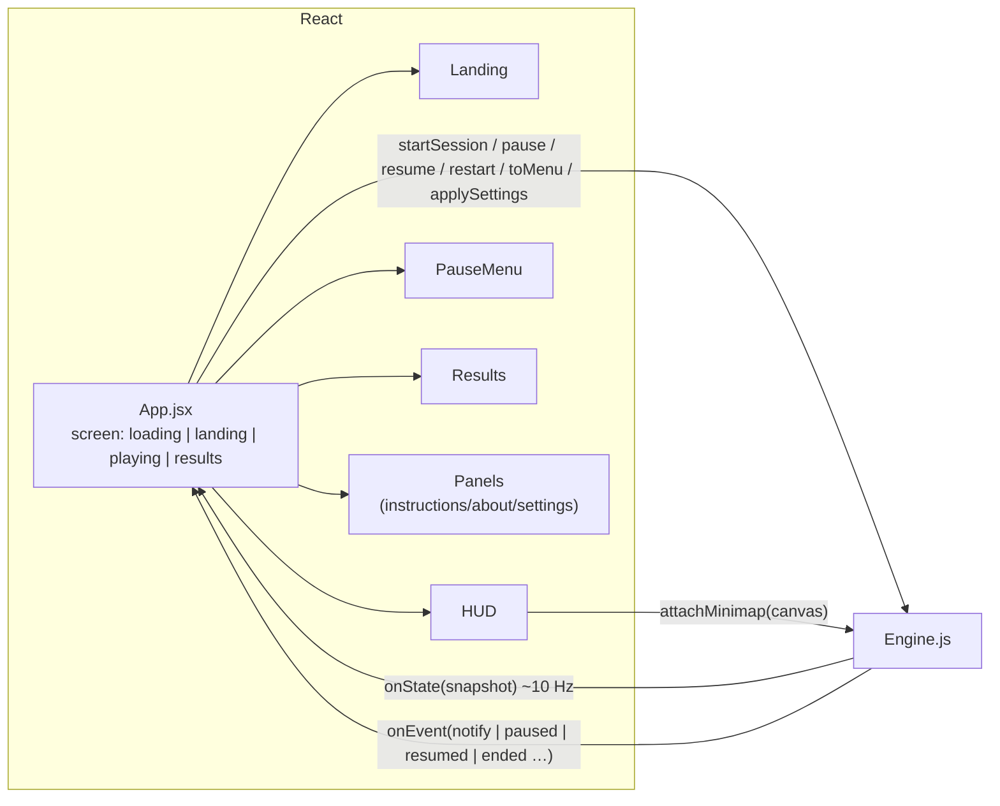
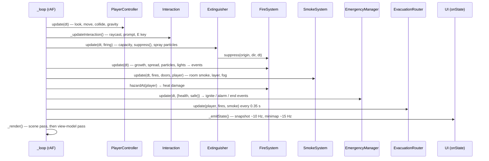
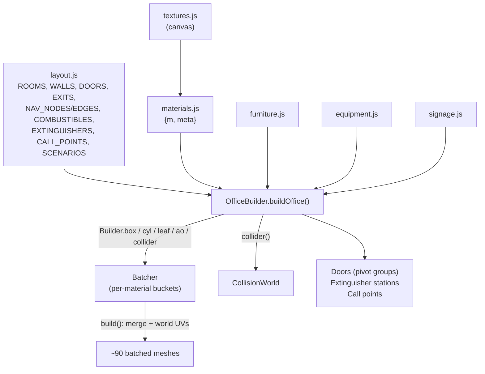
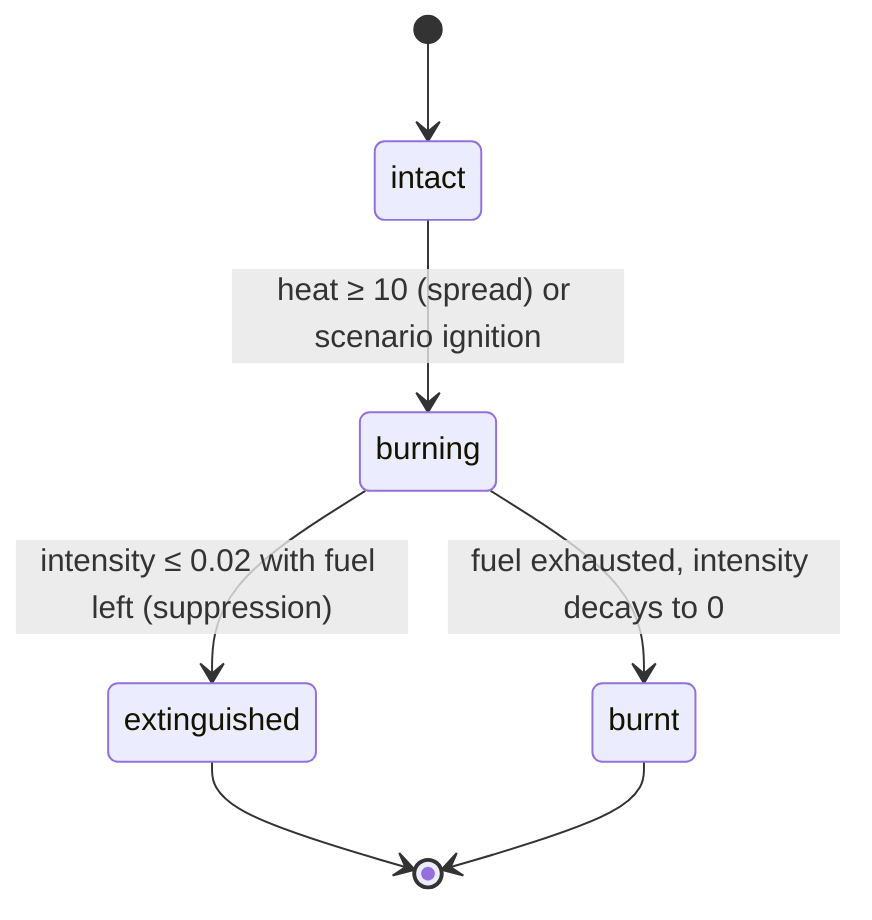
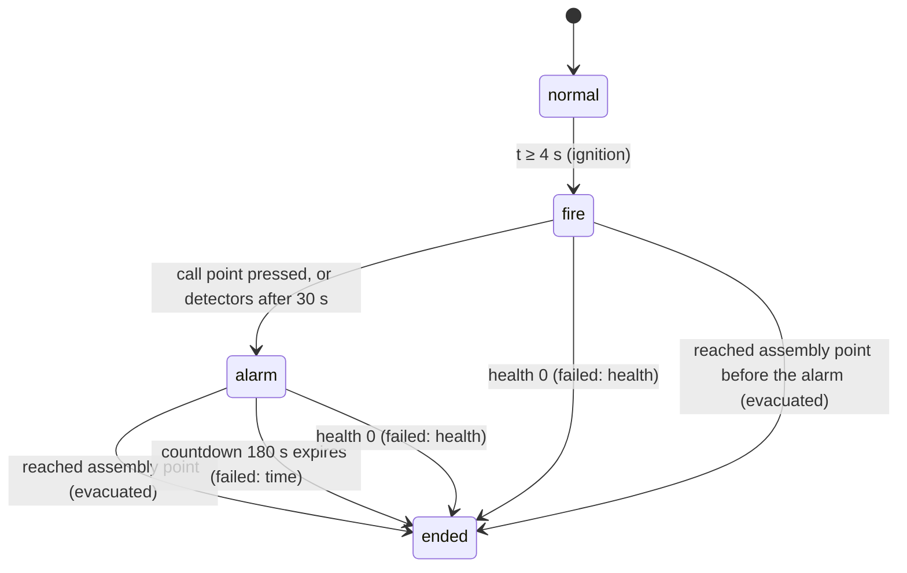

# Technical Architecture

This document describes the code structure of the Emergency Rescue & Evacuation Simulator: its
modules, their responsibilities, the data flow between them, and how the simulation systems interact.
File paths are relative to the repository root.

---

## 1. High-level structure

The application has two layers:

| Layer | Technology | Responsibility |
|---|---|---|
| **UI layer** (`src/App.jsx`, `src/ui/`) | React 18 | Screens, menus, HUD, results. It does not touch the 3D scene. |
| **Engine layer** (`src/engine/`) | Plain JavaScript + Three.js | Rendering, environment generation, simulation, input, audio. It has no React dependency. |

The two layers communicate in two directions:

- **UI → Engine:** method calls, for example `startSession`, `pause`, `resume`, `restart`, `toMenu`,
  `applySettings` and `attachMinimap`.
- **Engine → UI:** two callbacks passed to the constructor:
  - `onState(snapshot)` delivers a plain-object HUD snapshot about 10 times per second.
  - `onEvent(event)` delivers discrete events: `notify`, `paused`, `resumed`, `lock`, `ignite` and
    `ended` (which carries the results).

This separation means React never re-renders at frame rate, and the engine can be tested without the UI.



## 2. Directory layout

```
src/
├── main.jsx                 React root
├── App.jsx                  Screen state machine; owns the Engine instance
├── styles.css               All UI styling (CSS custom properties)
├── ui/
│   ├── Landing.jsx          Title, scenario selector, buttons, best score
│   ├── HUD.jsx              Status card, compass, minimap, vitals, fire card, extinguisher card, prompts, notifications
│   ├── PauseMenu.jsx        Resume / restart / instructions / settings / main menu
│   ├── Results.jsx          Outcome, rating, stats, breakdown, tips, incident timeline
│   └── Panels.jsx           Instructions, About, Settings modals
└── engine/
    ├── Engine.js            Orchestrator (see §3)
    ├── Settings.js          QUALITY presets; load/save settings and best score (localStorage)
    ├── environment/
    │   ├── layout.js        Floor-plan data (single source of truth)
    │   ├── OfficeBuilder.js Builds the level from layout.js
    │   ├── furniture.js     Procedural furniture functions
    │   ├── equipment.js     Extinguisher / call-point meshes (dynamic, not batched)
    │   ├── signage.js       Evacuation-plan textures
    │   ├── materials.js     Material library + per-material metadata
    │   ├── textures.js      Procedural canvas textures and sprites
    │   └── Batcher.js       Batcher (merge by material) + Builder (local frames)
    └── systems/
        ├── CollisionWorld.js
        ├── Input.js
        ├── PlayerController.js
        ├── FireSystem.js
        ├── SmokeSystem.js
        ├── ParticleSystem.js
        ├── Extinguisher.js
        ├── EmergencyManager.js
        ├── EvacuationRouter.js   (also exports ArrowGuide)
        ├── Minimap.js
        ├── AudioManager.js
        └── ScoreManager.js
tests/e2e.mjs                End-to-end test suite (puppeteer-core)
```

## 3. Engine (`src/engine/Engine.js`)

The `Engine` owns the renderer, the scene, the cameras, the lights and every system.

### 3.1 Initialisation (`_init`)

1. Create the `WebGLRenderer`:
   - ACES tone mapping, sRGB output and PCF soft shadows;
   - `autoClear = false`, so the view model can be drawn in a second pass.
2. Create the scene:
   - a sky background texture;
   - a PMREM-filtered `RoomEnvironment` as the environment map;
   - `PerspectiveCamera(72°, near 0.1, far 250)`.
3. Create the lights: hemisphere, shadow-casting directional, 5 fill point lights and one alarm point
   light.
4. Build the materials (`createMaterials`) and the collision world, then call
   `buildOffice(materials, collision)`. That call returns:
   - the static group;
   - the doors, extinguishers and call points;
   - the wall lines (used by the minimap).
5. Collect the interactive meshes for raycasting.
6. Create the view-model scene and camera (the extinguisher held in first person).
7. Create the systems: `Input`, `PlayerController`, `FireSystem`, `SmokeSystem`, `Extinguisher`,
   `EmergencyManager`, `EvacuationRouter`, `ArrowGuide`, `AudioManager` and `Minimap`.
8. Start **attract mode** (the landing-page fly-through) and the `requestAnimationFrame` loop.

### 3.2 Modes

| Mode | Behaviour |
|---|---|
| `attract` | The camera follows a closed Catmull–Rom spline. Decorative fires burn with spread disabled. Strobes flash. |
| `play` | Full simulation, when not paused, not ended, and the pointer is locked (or `allowUnlocked` is set for tests). |
| `play` + `ended` | Particles keep drifting; input is disabled; the results screen is shown by React. |

### 3.3 Frame update order (play mode)



### 3.4 Public API

| Method | Purpose |
|---|---|
| `startSession(scenarioId?)` | Reset all systems and start a scenario (random if none is given). Requests pointer lock. |
| `restart()` | Restart the current scenario. |
| `toMenu()` | Return to attract mode. |
| `pause()` / `resume()` | Pause and resume the simulation and audio. |
| `applySettings(settings)` | Apply quality, sensitivity and volume changes live. |
| `attachMinimap(canvas)` | Give the minimap its canvas. |
| `dispose()` | Release GPU resources and listeners. |
| `debugAdvance(seconds)`, `debugTeleport(x, z, yaw, pitch)` | Deterministic test hooks. The instance is exposed as `window.__ers`. |

## 4. Environment generation



- **`layout.js`** holds all level data: 9 rooms, 18 wall runs (with door, opening and exit gaps),
  6 doors, 3 exits with assembly points, 38 navigation nodes and 39 edges, 29 combustible zones,
  7 extinguishers, 5 call points and 4 scenarios. It also provides `roomAt(x, z)` and
  `insideBuilding(x, z, margin)`.
- **`Batcher`** collects transformed geometries per material key. `build()`:
  - converts mixed indexed/non-indexed geometry if needed;
  - strips unused attributes (keeping `color` for vertex-alpha decals);
  - optionally rewrites UVs using world-space box projection (`meta.worldUV`);
  - merges each bucket into one `Mesh`, with shadow flags taken from the metadata.
- **`Builder`** wraps a `Matrix4` local frame. Its primitive methods are `box`, `cyl`, `sphere`, `ball`,
  `cone`, `leaf`, `plane`, `edge`, `ao` and `geo`. `at()` composes child frames. `collider()` converts a
  local footprint into a world AABB.
- **`OfficeBuilder`** does the following:
  - builds wall runs (interior, glass and exterior-with-windows);
  - adds door frames and headers, exits (glazed leaves and canopy), floors, ceilings and roof;
  - places light panels, smoke detectors, strobes, room plates, evacuation plans, HVAC grilles and
    clocks;
  - places all furniture, the exterior and the skyline;
  - creates the dynamic **doors** (pivot group, a closed-state collider and an open-state collider),
    **extinguisher stations** and **call points**, and tags their meshes with
    `userData.interact = { type, … }`.

## 5. Simulation systems

### 5.1 `CollisionWorld`

| Member | Description |
|---|---|
| `add(x0, z0, x1, z1, tag, data)` | Insert an AABB into a 2 m uniform hash grid; returns the box (with an `enabled` flag) |
| `query(x0, z0, x1, z1)` | Broad phase over the overlapped cells, with stamp-based de-duplication |
| `resolveCircle(pos, r)` | Push a circle out of overlapping boxes (up to 3 iterations) |
| `segmentHits(a, b, filter, max)` | Slab-method segment-vs-AABB count |
| `lineOfSight(a, b)` | Whether `segmentHits` returns 0, considering structural boxes only (`wall`, `door`) |

Used by: `PlayerController` (movement), `Engine` (interaction line of sight), `FireSystem` (heat
attenuation, spray line of sight, radiant-heat line of sight, light occlusion) and `EvacuationRouter`
(visible start nodes).

### 5.2 `Input` and `PlayerController`

- **`Input`:**
  - tracks the held key set and per-frame edge-triggered presses, plus accumulated mouse deltas
    (spikes over 400 px are discarded);
  - records firing (left mouse button while locked) and the pointer-lock state;
  - provides an Esc hook, `reset()` and `endFrame()`.
- **`PlayerController`:** handles yaw/pitch mouse look, WASD movement relative to yaw with exponential
  acceleration, sprint and crouch, gravity and jump, sub-stepped collision, eye-height interpolation,
  head-bob and step events. The camera transform is written in `_apply()`.

### 5.3 `FireSystem` + `ParticleSystem`



- **Per-zone state:** `{ heat, fire, status }`, where status is `intact`, `burning`, `extinguished`
  or `burnt`.
- **`update(dt, time, camera)`** runs these phases in order and returns events (`spread`,
  `extinguished`, `burnedOut`):
  1. growth and fuel;
  2. propagation every 0.25 s;
  3. particle emission (flames, embers, smoke, steam);
  4. decals (glow, scorch, danger ring);
  5. light assignment (4 pooled lights, ranked by intensity, distance and visibility; smoothed
     `lightVis`).
- **`suppress(origin, dir, dt, time)`:** cone test against the base and upper flames, with range
  falloff and line of sight. Reduces intensity and returns `{onTarget, fires[{fire, eff}]}`.
- **`hazardAt(x, z)`:** returns `{dps, inFlames, radiant, nearest}` for the player's health.
- **`ParticlePool`:** typed-array pool with a ring buffer, CPU integration (buoyancy, gravity, drag,
  turbulence, ceiling deflection, per-particle room bounds) and a colour/alpha gradient over life. It
  draws as one `THREE.Points` with a custom GLSL `ShaderMaterial` (perspective point size, sprite
  texture, fog).

### 5.4 `SmokeSystem`

- Per-room concentration, with source, room↔corridor exchange (door-state dependent) and ventilation.
- Per-room smoke-layer meshes, positioned at `3.0 − 2.3·smoke`.
- Computes the player's local visibility loss from the room smoke, eye height relative to the layer,
  and nearby fires. Drives `FogExp2` density and colour. Provides `inhalationDps()`.

### 5.5 `Extinguisher`

- Holds `held`, `capacity` (100 → 0 at 7.5 %/s), usage and accuracy statistics.
- Owns the view-model mesh, which is animated by bob, recoil and lever movement.
- Owns the spray `ParticlePool`, which emits from the nozzle along the camera direction with random
  spread and inherits the player's velocity.

### 5.6 `EmergencyManager`



It also computes the context-sensitive **objective**, covering these cases: start of shift, raise the
alarm, stay low, tackle the fire safely, fight or flight, evacuate, and go to the assembly point.

### 5.7 `EvacuationRouter` and `ArrowGuide`

- `update(px, pz, fires, smoke)` runs **Dijkstra's algorithm**:
  - a virtual start node is connected to the nodes visible within 14 m;
  - edge cost is length plus a danger term (fire proximity, a blocked flag for large flames) plus a
    smoke term;
  - the best of three assembly nodes is chosen, with 15% hysteresis.
- It returns `{exitId, points, length, cost, blockedExits, hazardous}`.
- `route` is reset by `Engine.startSession`, so preferences do not carry over between sessions.
- **`ArrowGuide`** is an `InstancedMesh` of up to 70 chevrons placed along the route polyline, with
  per-instance colour animation.

### 5.8 `AudioManager`

The Web Audio graph is created on the first user gesture. It contains:

- looping noise sources, filtered for fire crackle and rumble (gain tied to fire proximity), the
  extinguisher hiss, and HVAC hum;
- a square-wave alarm oscillator alternating 800/970 Hz;
- one-shot synthesised blips and noise hits (footsteps, doors, pickups, warnings, success and failure).

### 5.9 `Minimap`

The static floor plan is pre-rendered once to an off-screen canvas. Each update draws doors,
equipment, the route, pulsing fires and a player arrow rotated by yaw.

### 5.10 `ScoreManager`

`computeResults(stats)` returns `{success, score, rating, label, breakdown[], tips[], stats{}, timeline[]}`.

## 6. Data flow for one interaction: opening a door

1. **Raycast.** `Engine._updateInteraction()` casts a ray from the camera centre (2.7 m). The hit mesh
   carries `userData.interact = { type: 'door', door }`.
2. **Line-of-sight check.** `collision.segmentHits(camera → hit point − 0.25 m along the ray)` returns 0
   structural hits, so the door is a valid target and the prompt `"Open door"` is set.
3. **Action.** On `E`, `_interact` toggles `door.open`, plays `audio.door()`, and counts a closed door
   for scoring.
4. **Animation.** `_animateDoors(dt)` eases the pivot rotation toward the open angle. While it moves,
   it toggles colliders: the closed box is active below 15% open, the open-leaf box above 80% open.
5. **Simulation effect.** The closed-door box is tagged `door`, which is structural. This
   automatically changes:
   - fire heat attenuation (`segmentHits` counts it as a wall);
   - smoke exchange (`SmokeSystem` reads `door.open`);
   - routing line of sight;
   - spray line of sight.

## 7. Rendering pipeline

| Pass | Content |
|---|---|
| Shadow pass | Directional light shadow map: walls, furniture and equipment |
| Main pass | Opaque batched meshes → transparent meshes (glass, decals, smoke layers, AO decals) → particles (`renderOrder` 4–5) → arrows (7) |
| View-model pass | `clearDepth()`, then the extinguisher scene with its own lights and the environment map |

Settings presets (`Settings.js → QUALITY`):

| Preset | Pixel ratio cap | Shadows | Shadow map | Particle factor |
|---|---|---|---|---|
| Low | 0.8 | off | — | 0.5 |
| Medium (default) | 1.25 | on | 2048 | 1.0 |
| High | 2.0 | on | 4096 | 1.3 |

## 8. Performance design

- **Batching:** about 78 draw calls and 117k triangles in game.
- **One draw call per particle pool.** Instancing is used for the route arrows.
- **Constant light count:** lights are pooled and only their intensity changes, so shaders are never
  recompiled at run time.
- **Throttling:** routing runs at about 3 Hz, the HUD snapshot at 10 Hz, the minimap at about 15 Hz,
  and fire propagation at 4 Hz.
- **Allocation-free hot paths:** particles use preallocated typed arrays, and collision queries reuse
  scratch arrays.
- **Clamped `dt`** (50 ms). Rendering continues while paused, but the simulation does not advance.

## 9. Persistence

`localStorage` keys (all accesses are wrapped in `try/catch`):

| Key | Contents |
|---|---|
| `ers.settings.v1` | `{quality, sensitivity, volume, showDangerRings}` |
| `ers.best.v1` | `{score, rating, date}`, saved only when the score is above 0 |
