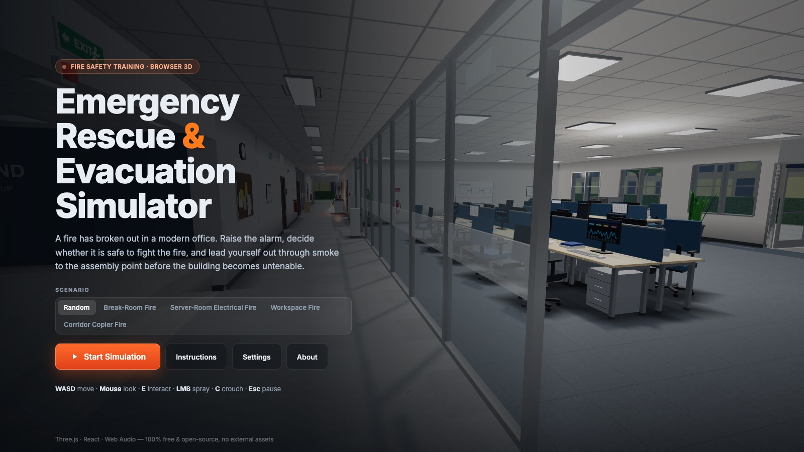
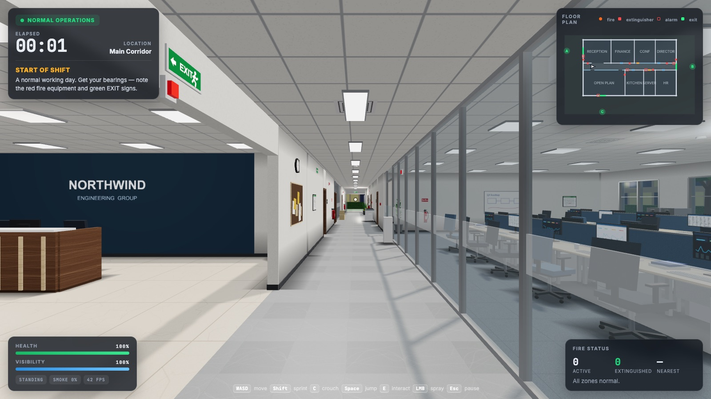
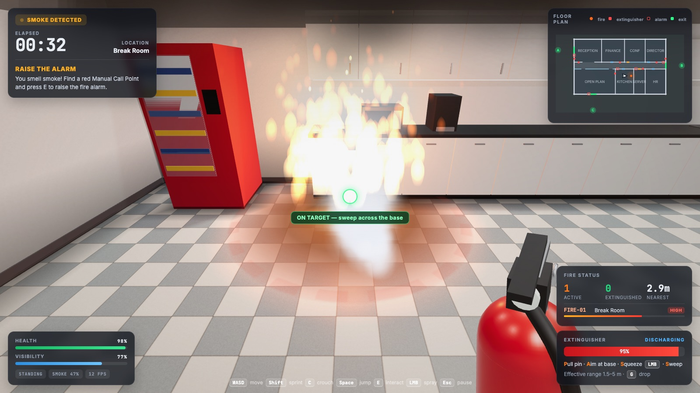
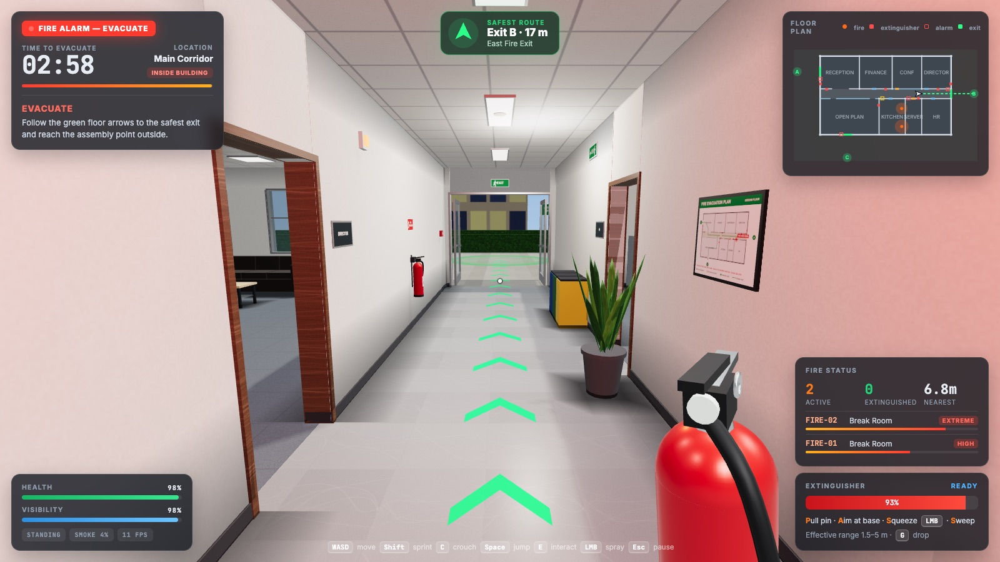
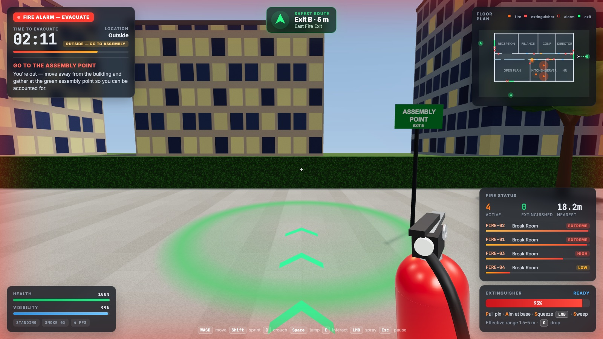
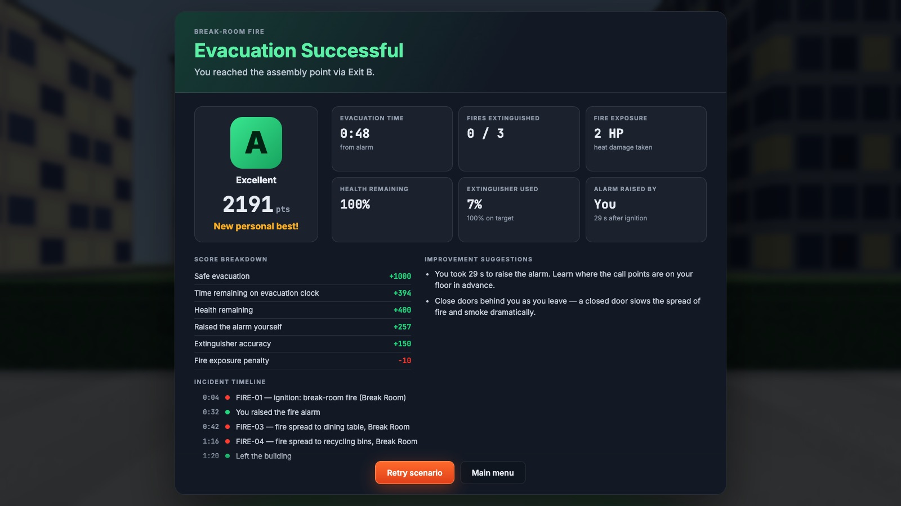

# User Guide

This guide explains, step by step, how to install, launch and play the **Emergency Rescue & Evacuation
Simulator**. No previous experience with games or 3D software is needed.

---

## 1. Before you start

You need:

- A **desktop or laptop computer** with a keyboard and a mouse (a touchpad works but a mouse is easier).
- A recent **Google Chrome**, **Microsoft Edge**, **Firefox** or **Safari** browser.
- **Node.js** (version 18 or newer). Download it free from https://nodejs.org. Choose the "LTS"
  version.
- Optionally, **headphones or speakers**. The alarm and fire sounds are part of the experience.

## 2. Installing

1. Download the project:
   - **With Git:**

     ```bash
     git clone https://github.com/aditya-sahay/emergency-rescue-evacuation-simulator.git
     ```

   - **Without Git:** on the GitHub page, click **Code → Download ZIP**, then unzip the file.
2. Open a terminal (Command Prompt / PowerShell on Windows, Terminal on macOS) in the project folder:

   ```bash
   cd emergency-rescue-evacuation-simulator
   ```

3. Install the dependencies (needed only once; it takes about a minute):

   ```bash
   npm install
   ```

## 3. Launching

```bash
npm run dev
```

The terminal prints an address such as `http://localhost:5173`. Open it in your browser. To stop the
program, press `Ctrl + C` in the terminal.

If you want the optimised version instead:

```bash
npm run build
npm run preview    # then open http://localhost:4173
```

## 4. The main menu



| Element | What it does |
|---|---|
| **Scenario** buttons | Choose which fire to practise, or **Random** |
| **Start Simulation** | Begins the selected scenario |
| **Instructions** | A summary of the controls and the correct fire response |
| **Settings** | Graphics quality (Low / Medium / High), mouse sensitivity and volume. Choose **Low** if the game feels slow |
| **About** | Information about the project |
| **Best score** | Your highest score so far, saved in your browser |

When you click **Start Simulation**, the browser captures your mouse pointer so you can look around.
If you see a **"Click to begin"** card, click once on the screen.

## 5. Controls

| Key / button | Action |
|---|---|
| `W` `A` `S` `D` (or arrow keys) | Walk forward / left / back / right |
| Move the mouse | Look around |
| `Shift` (hold) | Run |
| `C` | Crouch or stand up. Crouch in smoke! |
| `Space` | Jump |
| `E` | Use what you are looking at: open/close a door, pick up an extinguisher, press a fire alarm |
| Left mouse button (hold) | Spray the extinguisher |
| `G` | Drop the extinguisher |
| `Esc` | Pause (this also releases the mouse) |

When you look at something you can use, a prompt such as **`[E] Open door`** appears under the
crosshair (the small dot in the centre of the screen).

## 6. Understanding the screen (HUD)



| Area | Meaning |
|---|---|
| **Top-left card** | Emergency status (*Normal operations*, *Smoke detected* or *Fire alarm — evacuate*); the timer (elapsed time, or the **evacuation countdown** once the alarm sounds); your location; your evacuation status; and your **current objective** |
| **Top-centre (after the alarm)** | Route compass: the green arrow points toward the safest exit, with the distance |
| **Top-right** | Floor plan (minimap). The white arrow is you. Orange circles are fires, red squares are extinguishers, red outlines are alarm points and green marks are exits. After the alarm, a dashed green line shows your route |
| **Bottom-left** | **Health** and **Visibility** bars, smoke level in the room, and your posture (standing / crouching / sprinting) |
| **Bottom-right** | **Fire status**: active and extinguished counts, the distance to the nearest fire, and a list of fires with their danger level. When you hold an extinguisher, its **capacity** gauge appears here |
| **Centre** | Crosshair, interaction prompts, warnings and messages |

The screen edges glow **orange** when you are too close to a fire, **dark** when you are in smoke, and
**red** when you are hurt. They flash red in time with the fire alarm.

## 7. How to complete a scenario

Every scenario follows the same real-world fire procedure.

### Step 1 — Get your bearings (first 4 seconds)

The day starts normally. Look around. Notice the red extinguishers, the red alarm call points and the
green EXIT signs.

### Step 2 — Raise the alarm

A fire starts and the status changes to **Smoke detected**. Find a **red Manual Call Point**: a small
red box on the wall marked *FIRE ALARM*. Look at it and press `E`.

- You earn points for raising the alarm yourself, and more if you do it quickly.
- If nobody raises it, the smoke detectors trigger it after 30 seconds.

### Step 3 — Decide: fight or leave?

If the fire is **small** and you have a **clear escape route**, you may tackle it.

1. Pick up a wall-mounted **fire extinguisher** with `E`.
2. Stand **1.5–5 metres** from the fire.
3. Aim at the **base** of the flames, not at the top, and **hold the left mouse button**.
4. Watch the crosshair:
   - it turns **green**, with **"ON TARGET"**, when you are hitting the fire effectively;
   - otherwise a hint tells you what is wrong, for example *"Too far"* or *"Aim at the base"*.
5. The fire's bar in the fire list shrinks. At zero the fire is **extinguished**, and steam rises.



An extinguisher lasts about **13 seconds**. If it runs out and the fire is still burning, **leave**.
Don't stand in the red dashed **danger ring** around a fire, because it hurts you quickly.

### Step 4 — Evacuate

Once the alarm sounds, you have **3 minutes**. Follow the **green arrows on the floor** and the
**compass** at the top of the screen. The route automatically avoids fire and thick smoke, and it
changes if a fire blocks the way.



Good habits that also earn points:

- **Crouch (`C`) in smoke.** Smoke collects near the ceiling, so staying low keeps your visibility and
  health up.
- **Close doors behind you** (`E` on an open door). Closed doors slow the fire and the smoke.
- **Don't sprint into smoke you can't see through.**

### Step 5 — Reach the assembly point

Walking out of the door is not enough. Keep following the arrows to the **green circle** outside, next
to an **ASSEMBLY POINT** sign. The status then reads *Accounted for*, and the scenario ends.



### Ways to fail

| Cause | What happens |
|---|---|
| **Health reaches 0** | You stayed too close to fire or in smoke for too long |
| **The countdown reaches 0** | You didn't get out in time |

## 8. The results screen



| Section | Meaning |
|---|---|
| **Outcome** | *Evacuation Successful* or *Evacuation Failed*, with the reason |
| **Rating** | **S** (outstanding), **A**, **B**, **C**, **D** or **F** (unsafe) |
| **Score** | Your total points, and whether it is a new personal best |
| **Evacuation time** | How long it took you from the alarm (or from the start if you left before the alarm) |
| **Fires extinguished** | How many fires you put out, out of the total that burned |
| **Fire exposure** | How much heat damage you took |
| **Health remaining** | Your health at the end |
| **Extinguisher used** | How much agent you sprayed, and what percentage of that time you were on target |
| **Alarm raised by** | *You* or *Detectors*, and how quickly |
| **Score breakdown** | Exactly where your points came from and what cost you points |
| **Improvement suggestions** | Personalised advice based on what you did |
| **Incident timeline** | A time-stamped list of what happened: ignition, alarm, fire spread, extinguished fires, leaving the building, reaching the assembly point |

Use **Retry scenario** to try again, or **Main menu** to choose another scenario.

**How to score highly:**

1. Raise the alarm within a few seconds.
2. Put out a small fire using correct technique.
3. Avoid heat damage.
4. Close doors.
5. Get to the assembly point with plenty of time left.

## 9. Scenarios

| Scenario | Where the fire starts | Where you start |
|---|---|---|
| Break-room fire | Kitchen counter | Director's office |
| Server-room electrical fire | Server rack | Finance office |
| Workspace fire | Open-plan workstations | HR office |
| Corridor copier fire | Copier in the main corridor | Conference room |

## 10. Troubleshooting

| Problem | Solution |
|---|---|
| The mouse doesn't turn the camera | Click once on the 3D view. If the pause menu is open, click **Resume** |
| "Click to continue" keeps appearing | Browsers block re-capturing the mouse for about a second after you press `Esc`. Wait a moment, then click |
| The game is slow or jerky | Open **Settings** and choose **Low** quality; close other heavy browser tabs |
| No sound | Check the volume in **Settings** and your system volume. Sound starts after you click **Start** |
| Black screen / "WebGL could not start" | Update your browser and enable hardware acceleration in the browser settings |
| `npm install` fails | Make sure Node.js 18 or newer is installed (`node -v`) |
